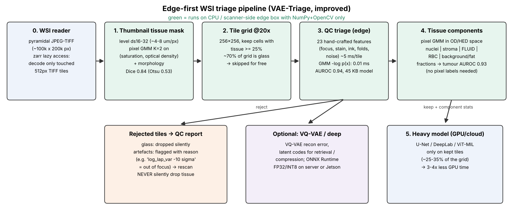
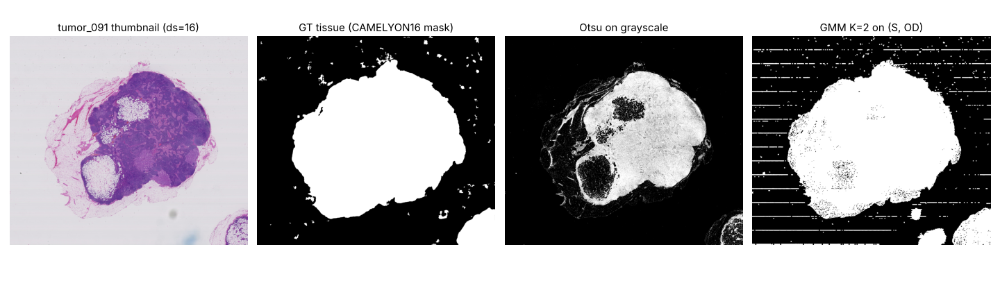
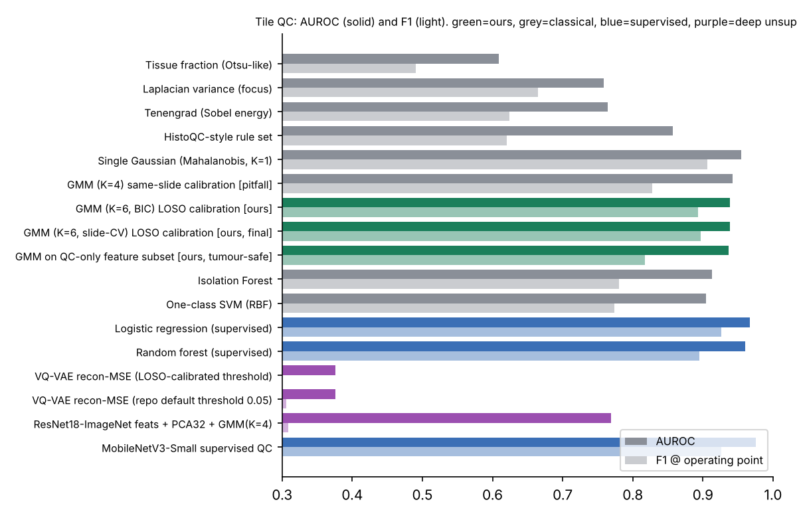
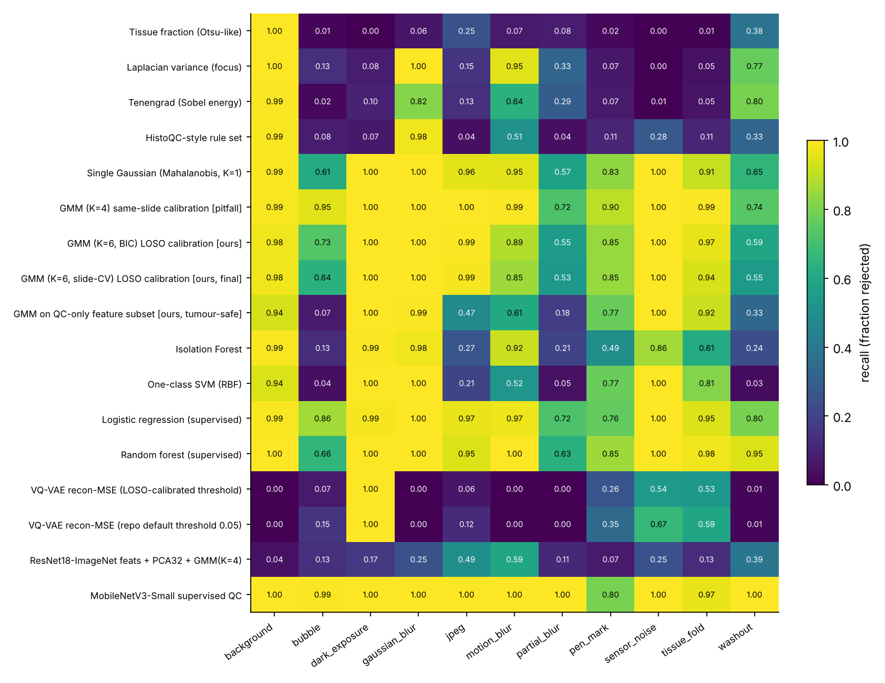
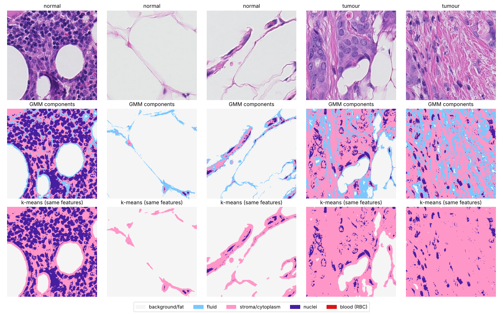
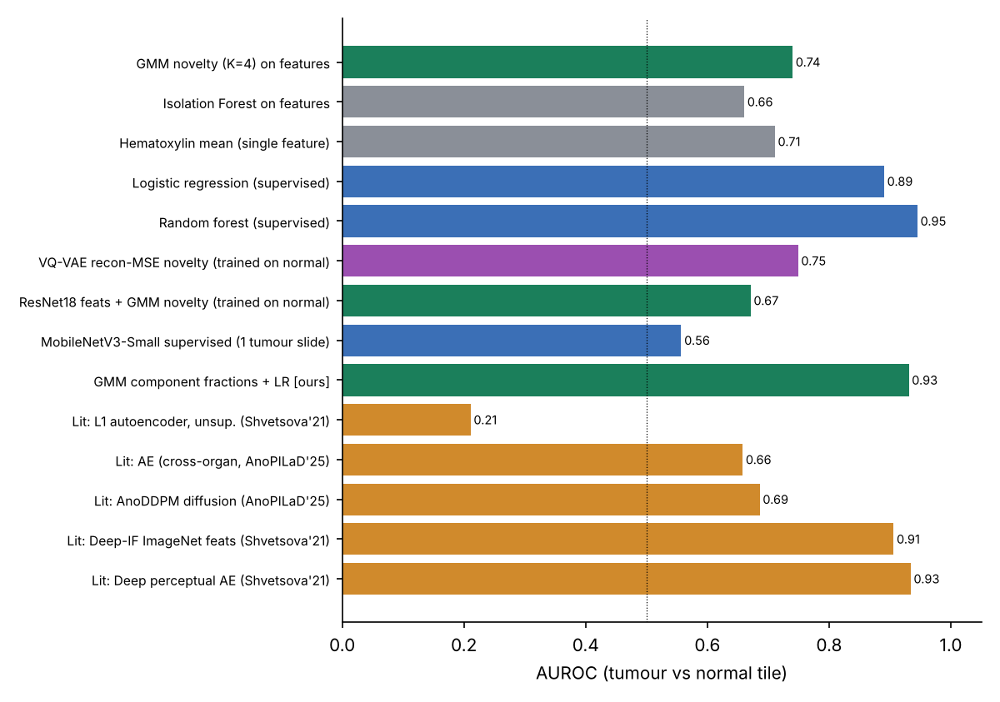

<p align="center">
  <h1 align="center">🔬 VAE-Triage — Edge-First Gigapixel Pathology Triage & QC</h1>
  <p align="center">
    <strong>Lazy WSI tiling · GMM tissue detection · GMM density QC · GMM tissue components (nuclei / stroma / fluid / blood / fat) · VQ-VAE · ONNX</strong>
  </p>
</p>

<p align="center">
  
  
  
  
</p>
<p align="center">
  
  
  
  
  
</p>

---

## 📋 Overview

A preprocessing **gate** for gigapixel H&E whole-slide images (WSIs, ~100k × 200k px) that runs *before* a heavy
segmentation model (U-Net / DeepLabv3+ / ViT-MIL).

Processing every tile of a WSI is expensive, and most of a slide is **empty glass**, **blur** or **artefacts**. Instead of running a heavy model on every tile, this pipeline:

1. **Tiles** the gigapixel image *lazily* (pyramid-aware, only the touched JPEG tiles are decoded — no out-of-memory).
2. **Removes glass** on a thumbnail with a 2-component **Gaussian Mixture Model** (Dice 0.84 vs 0.53 for Otsu).
3. **Triages tiles** with a GMM density over 23 physically meaningful features (focus, stain, pen ink, folds, noise):
   unusable tiles are flagged *with a reason*, good tiles pass. No artefact labels needed.
4. **Describes tissue** with a pixel-level GMM in optical-density space: **nuclei · stroma/cytoplasm · fluid · blood · fat**.
5. Optionally **compresses** valid tiles with a **VQ-VAE** (codebook latents) and exports models to **ONNX** (FP32 / INT8).

> 💡 **Why this matters:** in our 7 real CAMELYON16 slides, **69.6 % of 203,168 tiles are glass**. Only ~30 % of the grid
> should ever reach a GPU. The QC gate is a 45 KB NumPy model — it runs next to the scanner.

📑 **Full technical report:** [`report/Technical_Report.pdf`](report/Technical_Report.pdf) (37 pages) ·
[`report/REPORT.md`](report/REPORT.md) · 🎤 **Slides:** [`report/Interview_Slides.pptx`](report/Interview_Slides.pptx) ([PDF](report/Interview_Slides.pdf))

---

## 🏛️ Pipeline



| Stage | What | How | Cost |
|---|---|---|---|
| 0 | WSI reader | `tifffile` + `zarr`, pyramid levels, decode only touched tiles | O(tile) RAM |
| 1 | Tissue mask | Pixel GMM (K=2) on (HSV saturation, optical density) + morphology on a ~4–8 µm/px thumbnail | ms / slide |
| 2 | Tile grid | 256×256 @ 20×, keep cells with ≥ 25 % tissue | free |
| 3 | QC triage | 23 features → GMM `−log p(x)` → reject if > τ (τ = 95 % clean-pass on *unseen* slides) | 2.1 ms + 0.01 ms / tile |
| 4 | Tissue components | Pixel GMM (K=7) on [H, E, OD, a*, local std] → nuclei / stroma / **fluid** / blood / fat | ~5 ms / tile (128 px) |
| 5 | Heavy model | U-Net / DeepLab / ViT-MIL only on kept tiles | GPU |

---

## 📊 Results (real CAMELYON16 slides, slide-level split, CPU only)

Data: 7 breast lymph-node WSIs from CAMELYON16 (train: `normal_108`, `normal_150`, `tumor_082`; test: `tumor_075`, `tumor_079`,
`tumor_084`, `tumor_091`), expert tumour masks, tissue masks. 10 controlled artefacts injected into real clean tiles.

### Stage 1 — tissue detection


| Method | Dice | IoU |
|---|---|---|
| Fixed threshold (gray < 220) | 0.743 | 0.604 |
| Otsu on grayscale | 0.522 | 0.364 |
| Otsu on HSV saturation | 0.552 | 0.398 |
| K-means (k=2) | 0.138 | 0.078 |
| **GMM (K=2) on (S, OD) + morphology** | **0.839** | **0.746** |

### Stage 3 — tile QC (2290 clean tiles vs 600 glass + 1500 artefact tiles)


| Method | Labels? | AUROC | F1 | Specificity | Tumour wrongly rejected |
|---|---|---|---|---|---|
| Laplacian variance (focus) | no | 0.759 | 0.665 | 0.929 | 0.4 % |
| HistoQC-style rule set | no | 0.857 | 0.620 | 0.971 | 0.4 % |
| Isolation Forest | no | 0.913 | 0.780 | 0.929 | 0.4 % |
| **GMM density (ours)** | **no** | **0.939** | **0.897** | **0.928** | **3.5 %** |
| Single Gaussian (Mahalanobis) | no | 0.954 | 0.906 | 0.932 | 0.6 % |
| GMM, *same-slide* calibration ⚠️ | no | 0.942 | 0.828 | 0.687 | **43.1 %** |
| VQ-VAE reconstruction MSE (original idea) | no | **0.376** | 0.286 | 0.941 | 2.0 % |
| ResNet-18 ImageNet features + GMM | no | 0.769 | 0.309 | 0.928 | 4.3 % |
| Random forest on features | yes | 0.960 | 0.895 | 0.865 | 2.0 % |
| MobileNetV3-Small fine-tuned | yes | 0.976 | 0.926 | 0.873 | 5.1 % |



**Artefact types never seen in training** (supervised models saw the other 6 types; the GMM saw none):

| Model | bubble | pen ink | fold | JPEG |
|---|---|---|---|---|
| Logistic regression (supervised) | 0.13 | 0.64 | 0.41 | 0.46 |
| Random forest (supervised) | 0.07 | 0.64 | 0.24 | 0.22 |
| **GMM (unsupervised)** | **0.64** | **0.85** | **0.94** | **0.99** |

> ⚠️ **Key findings.** (1) The VQ-VAE reconstruction error is a *bad* QC score (AUROC 0.38): blurred and empty tiles are
> smooth and therefore **easier** to reconstruct. (2) Calibrating the threshold on tiles of the *same* slides rejects 43 %
> of tumour on new slides; leave-one-slide-out calibration → 3.5 %. (3) BIC over-estimates K because tiles of one slide are
> not i.i.d.; we choose K by held-out-slide likelihood.

### Stage 4 — GMM tissue components & fluid separation


Beer–Lambert → optical density → colour deconvolution (H, E) → pixel GMM. The pale, eosin-dominant, low-OD component is
**fluid** (proteinaceous fluid, plasma, oedema). k-means on the same features never isolates it.

| Check | Result |
|---|---|
| Agreement of two GMMs fitted on disjoint slides | 79 % of pixels (ARI 0.68) |
| Component fractions → tumour vs normal (AUROC) | **0.931** |
| Stroma/cytoplasm fraction alone | 0.928 |

### Tumour vs normal tiles (novelty detection)


### ⚡ Edge cost (4-vCPU container, no GPU)
| Component | ms / 256² tile | Size |
|---|---|---|
| 23 features on 128 px (AUROC 0.95, no loss) | 2.1 | – |
| GMM scorer (NumPy, `results/gmm_qc_model_final.json`) | 0.009 | 45 KB |
| VQ-VAE ONNX Runtime FP32 / INT8 | 22.9 / 22.7 | 2.9 / 0.8 MB |
| MobileNetV3-S ONNX Runtime FP32 / INT8 | 0.6 / 1.4 | 6.1 / 1.7 MB |

INT8 made the models 3.5–3.7× smaller but **not faster** on this CPU — always measure on the target device.

---

## 🐛 Fixes to the original code

| Problem | Fix |
|---|---|
| `train.py` / `triage.py` unpacked `vq_loss, recon, ppl = model(x)` but the model returns `(recon, vq_loss, ppl)` → `RuntimeError` in `backward()` | Fixed unpacking |
| `tifffile.memmap` fails on real (tiled, JPEG-compressed) WSIs | New `data/wsi.py` lazy zarr reader |
| Background filtering documented but not implemented | Thumbnail tissue mask in `GigapixelTileDataset` |
| No GMM in the code | `triage/gmm_triage.py`, `triage/gmm_components.py` |
| AMP `GradScaler` on CPU | CUDA-only |
| Arbitrary MSE threshold 0.05 | Percentile threshold calibrated on unseen slides |

---

## 📂 Project structure
```
VAE-Triage/
├── data/
│   ├── wsi.py                 # lazy pyramid-aware WSI reader (tifffile + zarr)
│   ├── dataset.py             # GigapixelTileDataset (tissue-filtered) + NpzTileDataset
│   └── transforms.py          # augmentations
├── models/vq_vae.py           # VQ-VAE (encoder, codebook quantiser, decoder)
├── training/train.py          # VQ-VAE training (fixed)
├── inference/
│   ├── triage.py              # VQ-VAE triage (fixed)
│   └── export.py              # ONNX export
├── triage/
│   ├── features.py            # 23 edge-friendly QC features
│   ├── gmm_triage.py          # GMM density QC + NumPy EdgeGMMScorer
│   ├── gmm_components.py      # pixel GMM: nuclei / stroma / fluid / blood / fat
│   └── artifacts.py           # 10 artefact simulators (blur, motion, ink, fold, ...)
├── benchmarks/                # all experiments (see below)
├── results/                   # raw JSON results + exported GMM models
├── report/                    # LaTeX report, PDF, Markdown, slides, figures
└── utils/dummy_data.py        # synthetic WSI (original demo)
```

---

## 🚀 Usage

```bash
pip install -r requirements.txt
```

**Edge QC on any tile**
```python
from triage.features import tile_features
from triage.gmm_triage import EdgeGMMScorer
scorer = EdgeGMMScorer("results/gmm_qc_model_final.json")   # 45 KB, NumPy only
x = tile_features(rgb_tile)[None]                            # (1, 23)
print(scorer.score(x), scorer.reject(x))                     # -log p(x), bool
```

**Tissue components (incl. fluid)**
```python
from triage.gmm_components import GMMTissueComponents
gc = GMMTissueComponents(k=7).fit(list_of_clean_tiles)
labels = gc.predict(rgb_tile)          # 0 bg/fat, 1 fluid, 2 stroma, 3 nuclei, 4 blood
fractions = gc.fractions(rgb_tile)
```

**Original VQ-VAE workflow (now working)**
```bash
python utils/dummy_data.py                                           # synthetic WSI (optional)
python training/train.py --image_path slide.tif --epochs 5 --batch_size 32
python inference/triage.py --image_path slide.tif --checkpoint checkpoints/vq_vae_epoch_5.pt
python inference/export.py --checkpoint checkpoints/vq_vae_epoch_5.pt --output_path vq_vae_triage.onnx
```

**Reproduce every number** (CAMELYON16 is free on AWS Open Data, no login)
```bash
python benchmarks/build_tiles.py               # tiles + slide census
python -m benchmarks.exp_tissue_detection      # stage 1
python -m benchmarks.exp_classical             # QC + tumour + statistics
python -m benchmarks.exp_gmm_components        # tissue components / fluid
python -m benchmarks.exp_ablations             # 128 px features, unseen artefacts
python -m benchmarks.exp_deep                  # VQ-VAE, MobileNetV3, ResNet18+GMM, ONNX (~2 h CPU)
cd report && python make_assets.py && python make_diagrams.py && pdflatex main.tex && python make_md.py && python make_slides.py
```
Download commands are in [report chapter 7](report/REPORT.md).

---

## ✨ Features
- Lazy, pyramid-aware tiling of real gigapixel WSIs (no OOM).
- Unsupervised, explainable GMM QC with per-feature z-score reasons; 45 KB NumPy model.
- GMM tissue-component maps (nuclei / stroma / fluid / blood / fat) from colour deconvolution.
- VQ-VAE compression with ONNX FP32/INT8 export.
- Benchmarked on real CAMELYON16 slides against Otsu, Laplacian, HistoQC-style rules, Isolation Forest, One-class SVM,
  random forest, MobileNetV3, ResNet-18 features and the literature.

## 📖 References
- Ruifrok & Johnston, *Colour deconvolution*, 2001 · van den Oord et al., *VQ-VAE*, NeurIPS 2017
- Bejnordi et al., *CAMELYON16*, JAMA 2017 · Bándi et al., *tissue segmentation*, PeerJ 2019
- Janowczyk et al., *HistoQC*, 2019 · Shvetsova et al., *Deep perceptual autoencoders* (arXiv:2006.13265)
- Stauffer & Grimson, *Adaptive background mixture models*, CVPR 1999
