---
author:
- |
  Prepared for the AIRA Matrix interview  
  All numbers in this report were measured in this study unless marked
  “literature”.
date: November 2026
title: |
  **Edge-First Image Analysis for Digital Pathology**  
  Technical report, benchmark study and interview guide for two
  projects:  
  *VAE-Triage* (gigapixel WSI triage) and
  *Satellite_based_tile_segmentation* (high-resolution segmentation)
---

- [Executive summary (read this
  first)](#executive-summary-read-this-first)
  - [What the two projects are, in one paragraph
    each](#what-the-two-projects-are-in-one-paragraph-each)
  - [Pipeline at a glance](#pipeline-at-a-glance)
  - [Headline numbers (all measured in this
    study)](#headline-numbers-all-measured-in-this-study)
  - [The six things the candidate must be able to
    say](#the-six-things-the-candidate-must-be-able-to-say)
- [Foundations you must know (learning
  chapter)](#foundations-you-must-know-learning-chapter)
  - [Digital pathology and the H&E
    image](#digital-pathology-and-the-he-image)
  - [Image processing essentials](#image-processing-essentials)
  - [Data augmentation (what, why, and what NOT to do in
    pathology)](#data-augmentation-what-why-and-what-not-to-do-in-pathology)
  - [Statistics you will be asked
    about](#statistics-you-will-be-asked-about)
  - [Evaluation metrics](#evaluation-metrics)
  - [Machine learning basics](#machine-learning-basics)
  - [Gaussian Mixture Models (the core of this project)](#sec:gmm)
  - [Neural networks for images](#neural-networks-for-images)
  - [Edge deployment essentials](#edge-deployment-essentials)
- [Project 1: VAE-Triage – gigapixel WSI
  triage](#project-1-vae-triage-gigapixel-wsi-triage)
  - [Problem statement (how to pitch
    it)](#problem-statement-how-to-pitch-it)
  - [The original repository and what was wrong](#sec:bugs)
  - [Data used](#data-used)
  - [Stage 0 – thumbnail tissue
    detection](#stage-0-thumbnail-tissue-detection)
  - [Stage 1 – tile QC with a GMM
    density](#stage-1-tile-qc-with-a-gmm-density)
  - [Stage 2 – GMM tissue components and fluid separation](#sec:fluid)
  - [Tumour triage (anomaly detection) and the deep
    baselines](#tumour-triage-anomaly-detection-and-the-deep-baselines)
  - [Edge cost](#edge-cost)
- [Project 2: High-resolution segmentation
  (Satellite_based_tile_segmentation)](#project-2-high-resolution-segmentation-satellite_based_tile_segmentation)
  - [Why this project matters for a pathology
    company](#why-this-project-matters-for-a-pathology-company)
  - [Architecture (as implemented in the
    repo)](#architecture-as-implemented-in-the-repo)
  - [Bugs and over-claims found](#bugs-and-over-claims-found)
  - [Experimental protocol](#experimental-protocol)
  - [Results](#results-1)
  - [Transfer to pathology
    segmentation](#transfer-to-pathology-segmentation)
- [Literature survey and baselines](#literature-survey-and-baselines)
  - [WSI quality control and tissue
    detection](#wsi-quality-control-and-tissue-detection)
  - [Anomaly / novelty detection on CAMELYON16 (unsupervised tumour
    detection)](#anomaly-novelty-detection-on-camelyon16-unsupervised-tumour-detection)
  - [Supervised CAMELYON16 / PCam (upper
    bounds)](#supervised-camelyon16-pcam-upper-bounds)
  - [Remote-sensing segmentation (ISPRS Potsdam, 5 classes, clutter
    excluded)](#remote-sensing-segmentation-isprs-potsdam-5-classes-clutter-excluded)
  - [Detection / instance
    segmentation](#detection-instance-segmentation)
  - [Key references](#key-references)
- [What to change in the projects, and why it helps on the
  edge](#what-to-change-in-the-projects-and-why-it-helps-on-the-edge)
  - [VAE-Triage: changes (done in this study unless marked
    TODO)](#vae-triage-changes-done-in-this-study-unless-marked-todo)
  - [Satellite repo: changes](#satellite-repo-changes)
  - [Edge deployment design for a pathology
    lab](#edge-deployment-design-for-a-pathology-lab)
- [Interview preparation](#interview-preparation)
  - [The 60-second pitch](#the-60-second-pitch)
  - [Likely questions with model
    answers](#likely-questions-with-model-answers)
  - [Do and don’t](#do-and-dont)
- [Reproducing everything](#reproducing-everything)
  - [Environment](#environment)
  - [Data](#data)
  - [VAE-Triage experiments](#vae-triage-experiments)
  - [Satellite experiments](#satellite-experiments)
  - [Using the edge scorer](#using-the-edge-scorer)

# Executive summary (read this first)

## What the two projects are, in one paragraph each

**VAE-Triage (pathology).** A whole-slide image (WSI) of an H&E-stained
breast lymph-node section is a $\sim$<!-- -->100,000 $\times$
200,000-pixel pyramidal TIFF. Most of it is empty glass, and some tissue
tiles are unusable (out of focus, pen ink, folds, bubbles). Running a
heavy segmentation network on every tile wastes GPU time and produces
garbage on artefacts. VAE-Triage is a *gate in front of the heavy
model*: it tiles the slide lazily, throws away glass, flags bad tiles
and keeps a compact description of the good tiles. In this study we
rebuilt it as an **edge-first, Gaussian-Mixture-Model (GMM) pipeline**
that runs on a CPU next to the scanner, and we kept the original VQ-VAE
as an optional deep component.

**Satellite_based_tile_segmentation (segmentation).** Semantic
segmentation of 6000$\times$<!-- -->6000-pixel aerial orthophotos (ISPRS
Potsdam, 6 classes) with a residual U-Net with a dilated (ASPP-like)
bottleneck, patch-based training, overlap stitching and 8$\times$
test-time augmentation. The *engineering problem is identical to WSI
segmentation*: an image too large for the network is cut into patches,
predicted, and stitched back. This is the project to talk about when the
interviewer asks “how do you do segmentation?”.

## Pipeline at a glance

<figure>
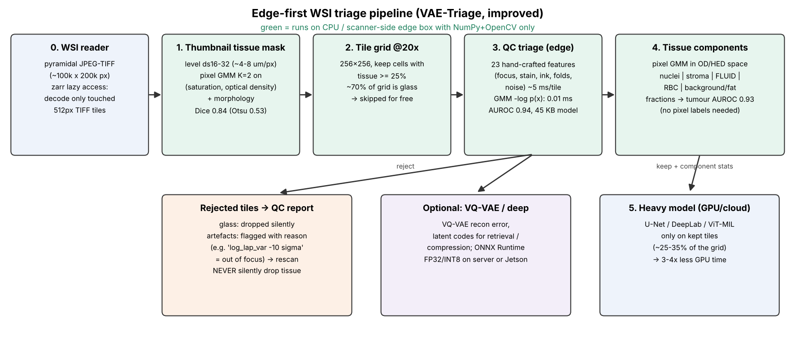
<figcaption>The improved VAE-Triage pipeline. Everything in green runs
on a CPU with NumPy + OpenCV only.</figcaption>
</figure>

## Headline numbers (all measured in this study)

Data: 7 real CAMELYON16 breast lymph-node WSIs (4.5 GB, 203,168 tiles at
20$\times$), expert tumour masks; ISPRS Potsdam RGB+NIR, 6 training
tiles + 3 official test tiles. CPU only (4 vCPU), no GPU.

| **Task**                                                 | **Best classical / ours**                                              | **Reference points**                                                                       |
|:---------------------------------------------------------|:-----------------------------------------------------------------------|:-------------------------------------------------------------------------------------------|
| Stage 0: tissue vs glass (Dice)                          | **GMM K=2 on (S, OD): 0.839**                                          | Otsu 0.52–0.55; fixed thr. 0.74; k-means 0.14                                              |
| Compute removed before any NN                            | **69.6% of 203k tiles are glass**                                      | 30–78% per slide                                                                           |
| Stage 1: tile QC (AUROC / F1)                            | **GMM 0.939 / 0.897**, single Gaussian 0.954 / 0.906                   | Laplacian 0.76; HistoQC-style rules 0.86; IsolationForest 0.91; supervised LR/RF 0.96–0.97 |
| Tumour wrongly rejected by QC                            | **3.5%** with slide-level calibration                                  | 43% with naive same-slide calibration (a trap!)                                            |
| Original VQ-VAE MSE as QC score                          | AUROC **0.376** (worse than chance)                                    | blur/glass reconstruct *better* than tissue                                                |
| Supervised MobileNetV3 QC                                | AUROC 0.976, 0.6 ms/tile (ORT)                                         | but recall 7–64% on artefact types not in training; GMM 64–99%                             |
| QC model size / cost                                     | **45 KB JSON, 1,799 numbers, 0.01 ms/tile** + 2.1 ms features (128 px) | VQ-VAE 0.69 M params, 22.9 ms/tile ORT                                                     |
| Tumour vs normal, no tumour labels                       | GMM novelty 0.740; VQ-VAE 0.749                                        | Lit. plain AE 0.66, L1-AE 0.21, perceptual AE 0.93                                         |
| Tumour via GMM tissue components (fluid, nuclei, stroma) | **0.931** (5 numbers per tile + LR)                                    | supervised RF on 23 features 0.945                                                         |
| Potsdam segmentation, classical (mIoU, 5 cls)            | GMM-Bayes + smoothing **45.9**; RF+NIR 48.4                            | k-means 15.7; lit. deep SOTA 86.5–87.5                                                     |

Summary. Deep-learning rows and the time-boxed U-Net / YOLO runs are in
the chapters and in the auto-generated tables.

## The six things the candidate must be able to say

1.  **Why triage at all:** 70% of a slide is glass and a few % is
    unusable; the GPU model should only see the remaining
    $\sim$<!-- -->30%. That is a 3–4$\times$ saving before any clever
    model.

2.  **Why a GMM and not a deep net for this gate:** the decision “is
    this tile normal-looking” is a *density estimation* problem; a GMM
    on 23 physically meaningful features gives 0.94 AUROC with a 45 KB
    model, microsecond scoring, no GPU, no labels, and a human-readable
    reason for every rejection.

3.  **Why a GMM and not k-means or Otsu:** k-means is a GMM with equal
    spherical covariances and hard assignments, so it splits large
    elongated clusters (stroma, fluid) and merges small ones; Otsu
    assumes one threshold on one channel. Measured: GMM Dice 0.84 vs
    Otsu 0.53 vs k-means 0.14 for tissue; only the GMM separates a fluid
    component.

4.  **The calibration trap:** if the reject threshold is set on tiles
    from the same slides it was fitted on, 43% of tumour tiles are
    rejected on new slides. Calibrate on *unseen slides*
    (leave-one-slide-out) – 3.5%.

5.  **The VQ-VAE finding:** reconstruction error ranks blurred and empty
    tiles as *more* normal (AUROC 0.38), so it must not be the QC score;
    keep the VQ-VAE as a compressor/tokeniser and a tumour-novelty
    signal (0.75).

6.  **Where deep learning is still needed:** the actual diagnosis
    (tumour segmentation, grading) – that is the U-Net project.
    Supervised deep models beat everything when labels exist; the GMM
    gate decides *where* to spend that compute.

> **Careful:** Do not claim numbers that are not in this report. The
> original README of the satellite repo lists per-class IoUs
> (e.g. building 0.85, car 0.82) that are not reproduced by any script
> in the repository. Say “on our re-run we get X”. Also: the original
> VAE-Triage training script crashed
> (Section <a href="#sec:bugs" data-reference-type="ref"
> data-reference="sec:bugs">3.2</a>); be honest that it was fixed during
> preparation.

# Foundations you must know (learning chapter)

This chapter is written to be read once, top to bottom. Each section
ends with what to say in an interview.

## Digital pathology and the H&E image

**Whole-slide image (WSI).** A glass slide scanned at 40$\times$
($\approx$<!-- -->0.25 $\mu$m/px) gives $10^{10}$ pixels. It is stored
as a *pyramid*: level 0 full resolution, each next level downsampled
$\times$<!-- -->2, each level cut into 256–512 px JPEG-compressed TIFF
tiles. A viewer (or our reader) only decodes the tiles it touches.
CAMELYON16 levels: 40$\times$, 20$\times$, 10$\times$, …; we tile at
level 1 (20$\times$, 0.49 $\mu$m/px), the usual magnification for
metastasis detection.

**H&E staining.** Haematoxylin binds DNA/chromatin $\Rightarrow$ nuclei
blue-purple. Eosin binds proteins $\Rightarrow$ cytoplasm, collagen,
*proteinaceous fluid* pink. Red blood cells are bright red/orange; fat
cells are empty (white) after processing.

**Beer–Lambert law and optical density.** Transmitted intensity
$I_c=I_{0}\,e^{-\sum_s \alpha_{s,c} C_s}$ for stains $s$ and colour
channel $c$. Taking logs gives the optical density
$$\mathrm{OD}_c=-\log_{10}\frac{I_c}{I_0}=\sum_s \alpha_{s,c}\,C_s ,$$
which is *linear* in stain concentration $C_s$. So in OD space every
pixel is a non-negative combination of the H and E stain vectors, and
**colour deconvolution** (Ruifrok & Johnston, 2001) recovers
$(C_H, C_E)$ by multiplying with the inverse stain matrix. A tissue fold
(double thickness) doubles OD; that is exactly how our fold simulator
works.

**Stain variation** (different labs, scanners, staining times) is the
biggest source of domain shift in pathology. Fixes: stain normalisation
(Reinhard, Macenko, Vahadane), stain augmentation (HED jitter), or
features that are invariant to it. We measured the shift between our 7
slides with the Jensen–Shannon divergence of RGB histograms
(Figure <a href="#fig:slidejs" data-reference-type="ref"
data-reference="fig:slidejs">3.1</a>).

**Common artefacts** (what QC must catch): out-of-focus (defocus) blur,
motion/stitching blur, pen marker, tissue folds, air bubbles,
over/under-staining or exposure, dust, JPEG compression, sensor noise.
**Fluids**: proteinaceous fluid, plasma, oedema and lymph appear as
pale, smooth, eosinophilic (pink) areas with few nuclei; in lymph nodes
they sit in sinuses and vessels. Separating them from stroma and nuclei
is a classic colour-clustering problem
(Section <a href="#sec:fluid" data-reference-type="ref"
data-reference="sec:fluid">3.6</a>).

## Image processing essentials

### Convolution and filtering

A linear filter computes $g(x,y)=\sum_{u,v} k(u,v)\,f(x-u,y-v)$. In the
Fourier domain it is a multiplication, $G=K\cdot F$, so a filter is
described by which frequencies it keeps.

- **Gaussian blur**: $k(u,v)\propto e^{-(u^2+v^2)/2\sigma^2}$. Low-pass;
  its Fourier transform is another Gaussian. It is the standard model of
  *defocus* (the optical point-spread function of an out-of-focus
  microscope is close to Gaussian/disc). Used to denoise before edge
  detection and to build scale-spaces. Separable: two 1-D passes.

- **Motion blur**: a 1-D box kernel along the motion direction (length
  $L$, angle $\theta$); its spectrum has zeros along a direction, which
  is how motion blur can be identified. In line-scan slide scanners it
  appears when the stage moves during exposure.

- **Median filter**: non-linear; removes salt-and-pepper noise while
  keeping edges. We use $|f-\mathrm{median}_3(f)|$ as a noise estimate.

- **Box/mean filter**, **bilateral filter** (edge-preserving), **unsharp
  masking** $f+\lambda(f-G_\sigma*f)$ for enhancement.

### Derivatives, focus measures and edges

- **Sobel** kernels estimate
  $\partial f/\partial x,\partial f/\partial y$ (derivative $\otimes$
  smoothing). **Tenengrad** focus $=\mathrm{mean}(G_x^2+G_y^2)$.

- **Laplacian** $\nabla^2 f$ responds to fine detail; the **variance of
  the Laplacian** (Pech-Pacheco et al., 2000) is the classic blur score:
  a blurred image has little high-frequency energy, so low variance.

- **Brenner gradient** $\sum (f(x+2)-f(x))^2$; **FFT high-frequency
  ratio** (energy outside a low-frequency disc). All four are in our
  23-D feature vector.

- **Canny edge detector**, 4 steps: (1) Gaussian smoothing, (2) Sobel
  gradient magnitude and direction, (3) non-maximum suppression along
  the gradient direction (thin edges), (4) double threshold + hysteresis
  (strong edges kept, weak edges kept only if connected to strong ones).
  We use Canny edge *density* as a structure feature: blur, washout and
  glass reduce it.

### Thresholding and morphology

**Otsu’s method** picks the threshold $t$ that maximises the
between-class variance $\sigma_B^2(t)=\omega_0\omega_1(\mu_0-\mu_1)^2$
of a 1-D histogram – equivalent to fitting two classes with equal
spread. It fails when one class is much broader than the other (faint
fat/loose tissue vs. tight glass), which is exactly what we measured
(Dice 0.53). **Morphology**: erosion/dilation with a structuring
element; opening (erode$\to$dilate) removes thin specks and scanner
stripes, closing (dilate$\to$erode) fills holes; connected-component
area filtering removes dust.

### Colour spaces

RGB (device), HSV (saturation separates stained tissue from grey glass),
CIE Lab (perceptually uniform; $a^*$ is red–green, good for blood),
OD/HED (physically linear in stain amount – the right space for GMMs on
H&E).

### Motion between frames (for completeness)

If asked “how do you find motion”: frame differencing; dense optical
flow (Lucas–Kanade assumes brightness constancy $I_x u+I_y v+I_t=0$ in a
window and solves least squares; Farnebäck fits polynomials);
**background subtraction with a per-pixel GMM** (Stauffer–Grimson /
OpenCV `MOG2`): each pixel’s history is a mixture of $K$ Gaussians,
components with high weight/low variance are background, a pixel not
matched by them is foreground. This is the most famous *edge* use of
GMMs (it runs on cheap CCTV hardware). In pathology, “motion” appears as
motion blur and as stitching misalignment between scanner stripes.

## Data augmentation (what, why, and what NOT to do in pathology)

Augmentation encodes invariances the model should have and reduces
overfitting.

- **Geometric**: rotations by 90$^\circ$ and flips (the dihedral group
  $D_4$, 8 elements) – tissue and aerial images have no canonical
  orientation; random crops; scale jitter (multi-scale patches, rates
  1–3 in the satellite repo); elastic deformation (U-Net paper) for cell
  shapes.

- **Photometric**: brightness/contrast/gamma, Gaussian blur and noise
  (robustness), JPEG.

- **Stain augmentation**: perturb the H and E concentrations
  ($C_s\leftarrow \alpha_s C_s+\beta_s$) in HED space (Tellez et
  al., 2019) – the single most effective augmentation for cross-centre
  generalisation; or random stain-normalisation targets.

- **Mixing**: MixUp/CutMix (careful with segmentation masks), copy-paste
  of objects (cars, cells).

- **Test-time augmentation (TTA)**: predict on the 8 $D_4$ transforms,
  undo each, average softmax maps. Costs 8$\times$ compute; usually
  +0.5–2 IoU points.

> **Careful:** Do not use hue jitter so strong that eosin turns blue –
> the model then cannot use colour at all. Do not apply augmentations
> that destroy the label (e.g. heavy blur on a “sharp” QC label). Our
> synthetic artefacts are the *opposite* use of the same functions: they
> create the reject class.

## Statistics you will be asked about

Let $\mathbf{x}\in\mathbb{R}^d$ be a feature vector,
$\bm\mu=\mathbb{E}[\mathbf{x}]$.

- **Covariance**
  $\Sigma=\mathbb{E}[(\mathbf{x}-\bm\mu)(\mathbf{x}-\bm\mu)^\top]$ – how
  features vary together (units: product of units). **Correlation**
  $\rho_{ij}=\Sigma_{ij}/\sqrt{\Sigma_{ii}\Sigma_{jj}}\in[-1,1]$ –
  unit-free. In our 23 features, tissue fraction correlates $-0.99$ with
  white fraction and $+0.93$ with mean OD; the eigen-spectrum shows that
  4 directions explain 90% of the variance and the covariance condition
  number is $1.4\times10^{13}$ – which is why the GMM needs *covariance
  regularisation* (`reg_covar`).

- **Mahalanobis distance**
  $D^2=(\mathbf{x}-\bm\mu)^\top\Sigma^{-1}(\mathbf{x}-\bm\mu)$: distance
  in units of the data’s own spread, accounting for correlation. A
  single Gaussian anomaly score is exactly $\tfrac12 D^2$ + const.

- **Entropy** $H(p)=-\sum p\log p$. **KL divergence**
  $D_{KL}(p\|q)=\sum p\log\frac{p}{q}\ge 0$, asymmetric, infinite if
  $q=0$ where $p>0$. **Jensen–Shannon**
  $JS=\tfrac12 D_{KL}(p\|m)+\tfrac12 D_{KL}(q\|m)$, $m=\tfrac{p+q}{2}$:
  symmetric, bounded in $[0,1]$ (base 2), and $\sqrt{JS}$ is a metric.
  We use JS to rank which feature each artefact moves
  (Table <a href="#tab:js" data-reference-type="ref"
  data-reference="tab:js">[tab:js]</a>) and to quantify stain shift
  between slides.

- **Likelihood, BIC, AIC**: $\mathrm{BIC}=-2\log L+p\log n$ penalises
  parameters $p$; lower is better. BIC assumes i.i.d. samples – tiles
  from one slide are *not* independent, so BIC over-estimates $K$; we
  select $K$ by held-out-*slide* likelihood instead.

## Evaluation metrics

Confusion matrix: TP, FP, TN, FN.

- **Precision** $=\frac{TP}{TP+FP}$ (of what I flagged, how much was
  right); **Recall/Sensitivity** $=\frac{TP}{TP+FN}$ (of what exists,
  how much I found); **Specificity** $=\frac{TN}{TN+FP}$; **F1**
  $=\frac{2PR}{P+R}$; accuracy is misleading under class imbalance.

- **ROC curve / AUROC**: TPR vs FPR over all thresholds; AUROC =
  probability a random positive scores above a random negative;
  threshold-free, insensitive to prevalence. **PR curve / AUPRC**:
  better when positives are rare (tumour tiles are 3% of tissue).

- **IoU (Jaccard)** $=\frac{|A\cap B|}{|A\cup B|}=\frac{TP}{TP+FP+FN}$;
  **Dice/F1** $=\frac{2|A\cap B|}{|A|+|B|}$; Dice
  $=\frac{2\,IoU}{1+IoU}$. **mIoU**: mean over classes (Potsdam usually
  excludes clutter). **OA**: pixel accuracy.

- Pathology-specific: **FROC** (CAMELYON16 lesion detection: sensitivity
  at 1/4,1/2,1,2,4,8 false positives per slide), slide-level AUC,
  Cohen’s $\kappa$ for grading agreement.

- **Operating point**: in QC we fix the false-rejection rate on good
  tissue (5%) and report recall of artefacts at that point; in screening
  we would fix sensitivity (e.g. 98%) and minimise false alarms.

## Machine learning basics

**Supervised** learning fits $p(y|\mathbf{x})$ from labelled pairs
(logistic regression, SVM, random forest, CNN). **Unsupervised**
learning models $p(\mathbf{x})$ or structure without labels (k-means,
GMM, PCA, autoencoders). **Self-supervised** creates labels from the
data itself (contrastive SimCLR/DINO, masked autoencoders) – the basis
of pathology foundation models. **Weakly supervised** uses coarse labels
(slide-level diagnosis) to learn tile-level decisions (multiple-instance
learning). **Semi-supervised**: few labels + many unlabelled images.
**One-class / novelty detection**: train only on normal data, flag what
is unlikely – our QC gate.

- **Logistic regression**:
  $p(y{=}1|\mathbf{x})=\sigma(\mathbf{w}^\top\mathbf{x}+b)$,
  cross-entropy loss, convex.

- **SVM**: max-margin hyperplane; kernels (RBF) for non-linear
  boundaries; **one-class SVM** encloses the normal data.

- **Decision trees / Random forest**: bagging of decorrelated trees
  (bootstrap + random feature subsets); robust, no scaling needed;
  strong tabular baseline. **Gradient boosting** (XGBoost/LightGBM) fits
  trees to residuals.

- **Isolation forest**: anomalies are isolated by fewer random splits.

- **PCA**: eigenvectors of $\Sigma$; decorrelates and reduces dimension.

- **Bias–variance**, regularisation (L2, dropout, early stopping),
  cross-validation *grouped by patient / slide* (otherwise leakage:
  tiles of the same slide in train and test inflate accuracy).

## Gaussian Mixture Models (the core of this project)

### Model

$$p(\mathbf{x})=\sum_{k=1}^K \pi_k\,\mathcal{N}(\mathbf{x}\mid\bm\mu_k,\Sigma_k),\qquad \pi_k\ge0,\ \textstyle\sum_k\pi_k=1,$$
$$\mathcal{N}(\mathbf{x}\mid\bm\mu,\Sigma)=(2\pi)^{-d/2}|\Sigma|^{-1/2}\exp\!\big(-\tfrac12(\mathbf{x}-\bm\mu)^\top\Sigma^{-1}(\mathbf{x}-\bm\mu)\big).$$
A GMM is a *soft clustering* and a *density estimator* at the same time.

### Fitting with Expectation–Maximisation (EM)

Introduce a latent component label $z$. Iterate:

E-step  
responsibilities
$\gamma_{nk}=\dfrac{\pi_k\mathcal{N}(\mathbf{x}_n|\bm\mu_k,\Sigma_k)}{\sum_j\pi_j\mathcal{N}(\mathbf{x}_n|\bm\mu_j,\Sigma_j)}$.

M-step  
$N_k=\sum_n\gamma_{nk}$, $\pi_k=N_k/N$,
$\bm\mu_k=\frac1{N_k}\sum_n\gamma_{nk}\mathbf{x}_n$,
$\Sigma_k=\frac1{N_k}\sum_n\gamma_{nk}(\mathbf{x}_n-\bm\mu_k)(\mathbf{x}_n-\bm\mu_k)^\top+\lambda I$.

Each iteration never decreases the log-likelihood; it converges to a
local optimum (so use several initialisations, k-means++ init).
$\lambda I$ (`reg_covar`) prevents singular covariances – essential with
correlated features.

### GMM vs k-means vs Otsu

k-means is the limit of EM with $\Sigma_k=\sigma^2 I$, equal $\pi_k$ and
$\sigma\to0$ (hard assignments): it can only draw *Voronoi* (straight,
equidistant) boundaries. A full-covariance GMM can represent elongated,
tilted clusters of different sizes and priors and gives calibrated
posteriors. Otsu = two 1-D classes with a single cut. In OD space, stain
clusters are elongated along stain vectors and the background is tiny
while stroma is broad – the GMM’s assumptions match the physics;
k-means’ do not. Measured: tissue Dice GMM 0.84 vs k-means 0.14; for
tissue components k-means never produces a separate fluid cluster.

### Three ways we use GMMs

1.  **Pixel GMM, $K=2$**, on (saturation, OD) of the thumbnail $\to$
    tissue vs glass (Stage 0).

2.  **Tile GMM density** $p(\mathbf{x})$ on 23 QC features of clean
    tiles; score $s(\mathbf{x})=-\log p(\mathbf{x})$; reject if $s>\tau$
    (Stage 1). Novelty detection.

3.  **Pixel GMM, $K=7$**, on \[H, E, OD, $a^*$, local std\] $\to$
    components named nuclei / stroma / **fluid** / blood / background
    (Stage 2); also a *GMM-Bayes classifier* for satellite pixels (one
    GMM per class, $\hat y=\arg\max_c \log p(\mathbf{x}|c)+\log\pi_c$).

> **Say it in the interview:** A GMM gives me a calibrated density with
> a few thousand parameters. On a CPU it scores a tile in microseconds,
> it needs no labels, and every rejection decomposes into per-feature
> z-scores, so a QC technician sees ‘focus 10 sigma below normal’
> instead of a black-box number.

## Neural networks for images

### CNN building blocks

Convolution (weight sharing, translation equivariance), receptive field,
stride/pooling (downsampling), batch normalisation, ReLU, dropout,
softmax + cross-entropy. **Dilated (atrous) convolution** inserts holes
in the kernel: receptive field grows without losing resolution; **ASPP**
(DeepLab) runs parallel dilations (1, 6, 12, 18) for multi-scale context
– the satellite repo’s bottleneck uses rates 1, 2, 4, 8.

### ResNet

Deep plain nets degrade (optimisation, vanishing gradients). A residual
block learns $F(\mathbf{x})$ and outputs $\mathbf{x}+F(\mathbf{x})$; the
identity path gives gradients a direct route
($\partial(\mathbf{x}+F)/\partial\mathbf{x}=I+\partial F/\partial \mathbf{x}$).
Variants: bottleneck
(1$\times$<!-- -->1-3$\times$<!-- -->3-1$\times$<!-- -->1),
pre-activation. ResNet-18/50 are the standard pathology backbones
(ImageNet or self-supervised pretrained).

> **Careful:** The satellite repo calls its blocks “residual” but it
> *concatenates* input and output (DenseNet-style), it does not add
> them. Know the difference.

### Efficient CNNs for edge

**MobileNet** (depthwise-separable conv: $3\times3$ per-channel +
$1\times1$ mixing, $\sim 8$–$9\times$ fewer FLOPs), inverted residuals,
squeeze-and-excitation, hard-swish (MobileNetV3); EfficientNet (compound
scaling).

### U-Net (segmentation)

Encoder (conv + downsampling) captures *what*; decoder (up-convolution)
recovers *where*; **skip connections** concatenate encoder features at
the same resolution so fine boundaries survive. Output: per-pixel
softmax. Losses: cross-entropy (pixel-wise), Dice/Jaccard loss (directly
optimise overlap, robust to imbalance), focal loss
$-(1-p_t)^\gamma\log p_t$ (down-weights easy pixels). Variants: U-Net++,
Attention U-Net, nnU-Net (self-configuring – the strongest medical
baseline), DeepLabv3+ (ASPP + decoder), HoVer-Net (nuclei instance
segmentation with horizontal/ vertical distance maps).

### Autoencoders, VAE and VQ-VAE

**Autoencoder**: encoder $z=f(\mathbf{x})$, decoder
$\hat{\mathbf{x}}=g(z)$, minimise $\|\mathbf{x}-\hat{\mathbf{x}}\|^2$.
**VAE**: probabilistic encoder
$q(z|\mathbf{x})=\mathcal{N}(\bm\mu,\mathrm{diag}\,\bm\sigma^2)$, prior
$p(z)=\mathcal{N}(0,I)$; maximise the ELBO
$$\log p(\mathbf{x})\ \ge\ \mathbb{E}_{q(z|\mathbf{x})}[\log p(\mathbf{x}|z)]-D_{KL}(q(z|\mathbf{x})\,\|\,p(z)),$$
with the *reparameterisation trick*
$z=\bm\mu+\bm\sigma\odot\bm\epsilon$. **VQ-VAE** (van den Oord et al.,
2017) replaces the continuous latent with a learned *codebook* of $K$
vectors $\{e_k\}$: $z_q=e_{k^*}$, $k^*=\arg\min_k\|z_e-e_k\|$. Loss
$\|\mathbf{x}-\hat{\mathbf{x}}\|^2+\|\mathrm{sg}[z_e]-e\|^2+\beta\|z_e-\mathrm{sg}[e]\|^2$
(reconstruction + codebook + commitment, $\beta=0.25$), gradients pass
the non-differentiable argmin with the *straight-through estimator*.
Perplexity $=\exp(H(\text{code usage}))$ measures how many codes are
used. Anomaly score = reconstruction error.

> **Careful:** Pixel-MSE reconstruction is a weak anomaly score for
> histology: autoencoders reconstruct tumour texture about as well as
> normal texture. Literature: L1-autoencoder AUROC 0.21 and plain AE
> 0.66 on CAMELYON16; a perceptual (VGG-feature) loss lifts it to 0.93.
> VQ-VAE is better positioned as a compressor/tokeniser than as a tumour
> detector.

### Object detection and YOLO (v8, v11)

Two-stage detectors (Faster R-CNN: region proposals + classification) vs
one-stage (SSD, RetinaNet, YOLO: dense prediction in one pass).
**YOLOv8** (Ultralytics, 2023): CSP backbone with *C2f* blocks, PAN-FPN
neck, *anchor-free decoupled head* (separate classification and box
branches), Distribution Focal Loss + CIoU for boxes, task-aligned label
assignment; `-seg` variants add a YOLACT-style mask head (prototype
masks $\times$ per-instance coefficients). **YOLO11** (2024): *C3k2*
blocks, *C2PSA* (partial spatial attention) block, fewer parameters for
the same mAP (YOLO11m $\approx$ 22% fewer params than YOLOv8m at higher
COCO mAP). Metrics: mAP@0.5, mAP@0.5:0.95. NMS removes duplicate boxes
(YOLOv10 removes NMS by consistent dual assignment). In pathology YOLO
is used for *countable objects*: mitotic figures, nuclei, glomeruli,
“cells per mm$^2$”; in aerial imagery: cars. Semantic segmentation
(U-Net) labels every pixel; instance segmentation (YOLO-seg, Mask R-CNN)
separates touching objects.

### Transformers

Self-attention $\mathrm{softmax}(QK^\top/\sqrt{d})V$ relates every token
to every other: global context, $O(N^2)$ cost. **ViT**: image $\to$
16$\times$<!-- -->16 patches $\to$ tokens. **Swin**: windowed attention
with shifted windows (linear cost, hierarchical). Segmentation:
SegFormer, Segmenter, UNetFormer (CNN encoder + transformer decoder;
86.8% mIoU on Potsdam), TransUNet, Swin-UNETR (medical). Pathology:
**foundation models** pretrained self-supervised on millions of tiles –
CTransPath, UNI, Virchow, Prov-GigaPath, CONCH (vision-language);
slide-level **multiple-instance learning**: ABMIL (attention pooling),
CLAM, TransMIL. They are the current SOTA but need GPUs; our triage gate
reduces how many tiles they must embed.

### Generative and RL approaches (know they exist)

GANs (f-AnoGAN for anomaly detection; stain transfer with CycleGAN),
diffusion models (AnoDDPM, AnoPILaD: 0.89 patch AUROC on CAMELYON16
cross-organ). **Reinforcement learning** in pathology: learning *where
to look* – an agent selects which region/magnification to zoom into next
(mimicking a pathologist), trading accuracy for number of tiles read; RL
is also used for adaptive scan planning. It is the learned version of
what our rule-based triage does.

## Edge deployment essentials

- **Why edge**: slides are 1–4 GB; uploading every slide to the cloud is
  slow and raises privacy issues; scanner-side PCs and Jetson-class
  boxes have limited GPU. Doing triage at the edge means only useful
  tiles (or only QC failures) leave the site.

- **ONNX** = framework-neutral graph format; **ONNX Runtime** executes
  it on CPU (MLAS), CUDA, TensorRT, OpenVINO, CoreML, etc. with graph
  optimisations (constant folding, operator fusion).

- **Quantisation**: FP32$\to$FP16/INT8; static INT8 needs a calibration
  set to fix activation ranges; dynamic quantisation only for
  weights/linear layers. Typical: 4$\times$ smaller, 2–4$\times$ faster
  on supporting hardware, small accuracy loss – *always re-validate*.

- Pruning, knowledge distillation (small student mimics big teacher),
  TensorRT engine building, batching, tiling I/O (JPEG decode often
  dominates!).

- **Classical models are the extreme of edge**: our GMM is 1,799 numbers
  in a 45 KB JSON file and is scored by 15 lines of NumPy
  (`EdgeGMMScorer`).

# Project 1: VAE-Triage – gigapixel WSI triage

## Problem statement (how to pitch it)

A pathology lab digitises hundreds of slides per day. Each WSI has
$10^5$ tiles at 20$\times$. A segmentation or classification network
(U-Net, DeepLab, ViT/MIL) costs 10–100 ms per tile on a GPU. Before
spending that compute we want to answer, *per tile and on cheap
hardware*: (1) is there tissue? (2) is the tile technically usable
(focus, ink, folds, exposure)? (3) what is in it (nuclei, stroma, fluid,
blood, fat)? Tiles that fail (1) are dropped, tiles that fail (2) are
*reported* (rescan request), and only the rest are sent to the heavy
model.

> **Say it in the interview:** The triage gate is the cheapest place to
> save compute and to catch bad scans early. I built it as an
> unsupervised density model so it needs no artefact annotation and runs
> on the scanner PC.

## The original repository and what was wrong

Original design: tile a TIFF with `tifffile.memmap`; train a VQ-VAE on
all tiles; flag tiles whose reconstruction MSE exceeds 0.05; export to
ONNX. Problems found while reproducing it:

1.  **Training and triage crashed.** `VQVAE.forward` returns
    `(x_recon, vq_loss, perplexity)` but `train.py` and `triage.py`
    unpacked `vq_loss, data_recon, perplexity = model(x)`. The “loss”
    became an image-shaped tensor and `backward()` raised
    `RuntimeError: grad can be implicitly created only for scalar outputs`
    (reproduced). Fixed.

2.  **It cannot open real WSIs.** `tifffile.memmap` works only on
    uncompressed contiguous TIFFs; every scanner WSI (and every
    CAMELYON16 slide) is a tiled JPEG-compressed pyramid. Replaced by
    `data/wsi.py`: a zarr-backed lazy reader that decodes only the TIFF
    tiles a request touches and exposes all pyramid levels.

3.  **Background filtering was documented but not implemented** – every
    tile, including 70% glass, went to the network. Now a thumbnail
    tissue mask selects tiles.

4.  **No GMM anywhere**, although the project is described as GMM-based
    triage. Added `triage/gmm_triage.py`, `triage/gmm_components.py` and
    the thumbnail GMM.

5.  AMP `GradScaler` was used unconditionally (warns/no-op on CPU);
    fixed to CUDA-only.

6.  The fixed MSE threshold 0.05 is arbitrary; we calibrate thresholds
    as percentiles on unseen slides.

7.  Synthetic “WSI” only (random noise + a black square) – no evidence
    on real data. We benchmarked on real CAMELYON16 slides.

## Data used

CAMELYON16 (Radboud UMC + UMC Utrecht; sentinel lymph nodes of
breast-cancer patients; H&E; 399 WSIs, 750 GB; AWS Open Data). We
downloaded 7 slides (2 normal, 5 tumour; 4.5 GB) with expert tumour
masks and the provided tissue/background masks. Tiles:
256$\times$<!-- -->256 at level 1 (20$\times$). Labels from masks:
*normal* (tissue $\ge$<!-- -->60%, no tumour), *tumour* (tumour
$\ge$<!-- -->60%), *background* (tissue $\le$<!-- -->2%), *border*.
**Split by slide**: train = normal_108, normal_150, tumor_082; test =
tumor_075, 079, 084, 091.

**Whole-slide tile census: what Stage 0 removes before any neural network runs.**

| Slide | Grid tiles (256 px @20x) | Tissue tiles | Glass (skipped) | Tumour tiles |
|---|---|---|---|---|
| normal_108 | 6160 | 4279 | 30.5% | 0 |
| normal_150 | 15232 | 5215 | 65.8% | 0 |
| tumor_075 | 27104 | 11967 | 55.8% | 312 |
| tumor_079 | 73920 | 16389 | 77.8% | 97 |
| tumor_082 | 46648 | 10088 | 78.4% | 1038 |
| tumor_084 | 21504 | 8409 | 60.9% | 186 |
| tumor_091 | 12600 | 5419 | 57.0% | 242 |
| TOTAL | 203168 | 61766 | 69.6% | 1875 |


<figure>
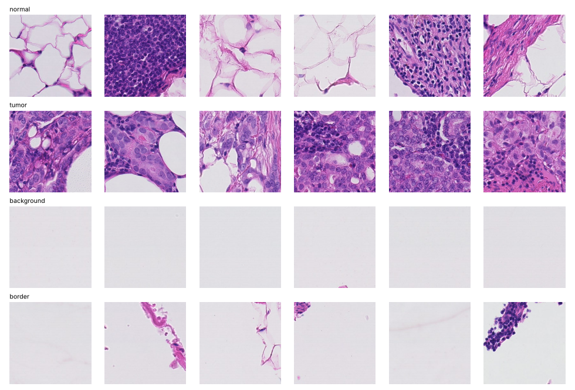
<figcaption>Real tiles: normal (note fat), tumour (metastatic
carcinoma), glass, partial tissue.</figcaption>
</figure>

##### Artefact ground truth.

No public pixel-level artefact labels exist for CAMELYON16, so – as in
focus-quality literature – we inject 10 controlled artefacts into real
clean tiles (150 each on test slides; a different random seed on
training slides is used *only* by supervised baselines): Gaussian blur
($\sigma$=1.5–4), motion blur (9–25 px), partial blur, pen ink, tissue
fold (Beer–Lambert 2–3$\times$ OD), air bubble, washout, dark exposure,
sensor noise, JPEG (q=3–10).

<figure>
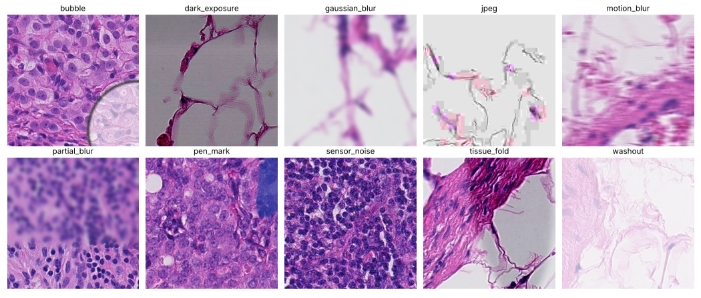
<figcaption>The 10 artefact simulators.</figcaption>
</figure>

## Stage 0 – thumbnail tissue detection

On a $\sim$<!-- -->4–8 $\mu$m/px thumbnail we compare thresholding,
k-means and a 2-component GMM on (HSV saturation, optical density), with
morphological opening/closing and small-component removal (scanner
stripes and dust).

**Stage-0 tissue detection on 7 CAMELYON16 slides (mean over slides).**

| Method (thumbnail, ~4-8 um/px) | Dice | IoU | Precision | Recall |
|---|---|---|---|---|
| Fixed threshold (gray < 220) | 0.743 | 0.604 | 0.890 | 0.669 |
| Otsu on grayscale | 0.522 | 0.364 | 0.986 | 0.365 |
| Otsu on HSV saturation | 0.552 | 0.398 | 0.999 | 0.398 |
| Otsu on saturation + morphology | 0.534 | 0.381 | 0.999 | 0.381 |
| K-means (k=2) on (S, OD) | 0.138 | 0.078 | 0.982 | 0.079 |
| GMM (K=2) on (S, OD) + morphology [ours] | 0.839 | 0.746 | 0.929 | 0.805 |


<figure>
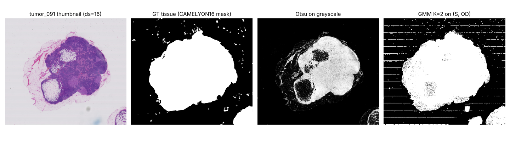
<figcaption>Otsu misses faint fat/loose tissue (it assumes two equally
spread classes); the GMM captures the broad tissue cluster. Remaining
GMM errors: scanner stripes in glass (removed by opening) and the
perinodal fat that the reference mask excludes.</figcaption>
</figure>

> **Key idea.** Glass is a tight cluster, tissue a broad one. A GMM
> models unequal variances and priors; Otsu and k-means do not. Dice
> 0.84 vs 0.53 (Otsu) vs 0.14 (k-means).

## Stage 1 – tile QC with a GMM density

### Features (23, all physically motivated)

Tissue: tissue fraction, white fraction, dark fraction. Stain: mean/std
of OD, of H and E concentrations (colour deconvolution),
saturation/value statistics, non-H&E-hue fraction (pen ink),
colourfulness. Focus: log Laplacian variance, log Tenengrad, log
Brenner, contrast-normalised Laplacian, FFT high-frequency ratio.
Structure: Canny edge density, grey-level entropy. Noise: residual vs
median filter. Cost: $\sim$<!-- -->5 ms per 256$^2$ tile (one core).

### Model and calibration

Robust standardisation (median/IQR) $\to$ full-covariance GMM fitted by
EM on clean training tiles, $K$ chosen by held-out-slide log-likelihood;
score $-\log p(\mathbf{x})$; threshold = 95th percentile of scores on
*unseen* training slides (leave-one-slide-out). The exported model is a
45 KB JSON (means, Cholesky factors of precisions, weights) scored by
NumPy in 0.01 ms/tile.

### Results

**Stage-1 tile QC on 4 unseen test slides: 2290 clean tissue tiles vs. 600 glass + 1500 artefact tiles. Unsupervised thresholds calibrated on unseen training slides (95\% clean pass).**

| Method | AUROC | AUPRC | Prec. | Recall | F1 | Spec. | Tum. rej. |
|---|---|---|---|---|---|---|---|
| Tissue fraction (Otsu-like) | 0.609 | 0.690 | 0.833 | 0.348 | 0.491 | 0.936 | 0.004 |
| Laplacian variance (focus) | 0.759 | 0.794 | 0.874 | 0.537 | 0.665 | 0.929 | 0.004 |
| Tenengrad (Sobel energy) | 0.764 | 0.792 | 0.847 | 0.494 | 0.624 | 0.918 | 0.004 |
| HistoQC-style rule set | 0.857 | 0.861 | 0.936 | 0.463 | 0.620 | 0.971 | 0.004 |
| Single Gaussian (Mahalanobis, K=1) | 0.954 | 0.943 | 0.923 | 0.890 | 0.906 | 0.932 | 0.006 |
| GMM (K=4) same-slide calibration [pitfall] | 0.942 | 0.936 | 0.735 | 0.948 | 0.828 | 0.687 | 0.431 |
| GMM (K=6, BIC) LOSO calibration [ours] | 0.939 | 0.933 | 0.894 | 0.892 | 0.893 | 0.903 | 0.084 |
| GMM (K=6, slide-CV) LOSO calibration [ours, final] | 0.939 | 0.933 | 0.918 | 0.876 | 0.897 | 0.928 | 0.035 |
| GMM on QC-only feature subset [ours, tumour-safe] | 0.937 | 0.928 | 0.944 | 0.721 | 0.818 | 0.961 | 0.002 |
| Isolation Forest | 0.913 | 0.876 | 0.899 | 0.690 | 0.780 | 0.929 | 0.004 |
| One-class SVM (RBF) | 0.905 | 0.904 | 0.938 | 0.658 | 0.773 | 0.960 | 0.006 |
| Logistic regression (supervised) | 0.966 | 0.949 | 0.925 | 0.927 | 0.926 | 0.931 | 0.004 |
| Random forest (supervised) | 0.960 | 0.955 | 0.863 | 0.930 | 0.895 | 0.865 | 0.020 |
| VQ-VAE recon-MSE (LOSO-calibrated threshold) | 0.376 | 0.517 | 0.736 | 0.178 | 0.286 | 0.941 | 0.020 |
| VQ-VAE recon-MSE (repo default threshold 0.05) | 0.376 | 0.517 | 0.582 | 0.207 | 0.305 | 0.863 | 0.129 |
| ResNet18-ImageNet feats + PCA32 + GMM(K=4) | 0.769 | 0.708 | 0.714 | 0.197 | 0.309 | 0.928 | 0.043 |
| MobileNetV3-Small supervised QC | 0.976 | 0.958 | 0.876 | 0.982 | 0.926 | 0.873 | 0.051 |


<figure>
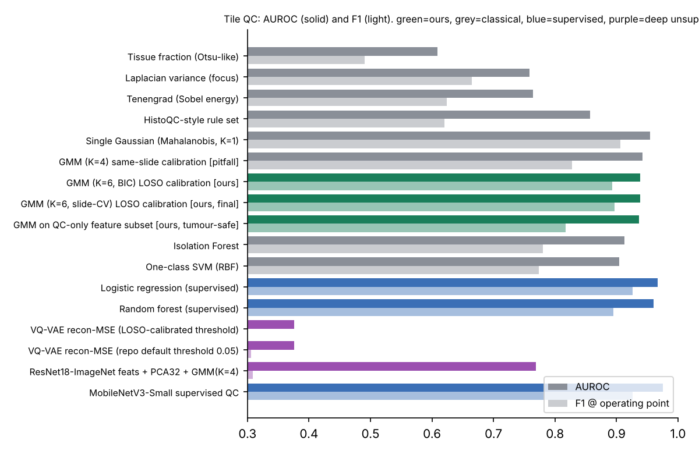
<figcaption>QC methods, test slides.</figcaption>
</figure>

<figure>
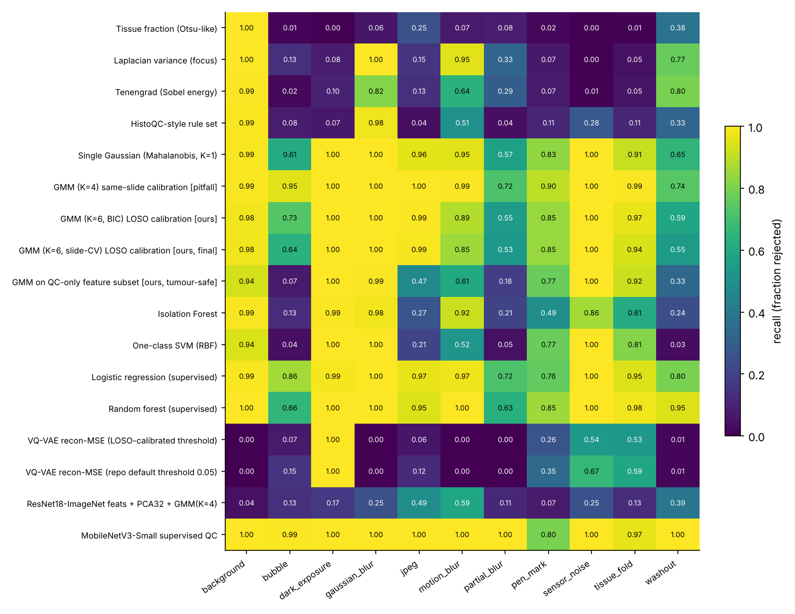
<figcaption>Recall per artefact at the operating point. Single-cue
methods catch one artefact family each (Laplacian: blur; tissue
fraction: glass); the density models catch nearly all; partial blur,
bubbles and washout are hardest.</figcaption>
</figure>

<figure>
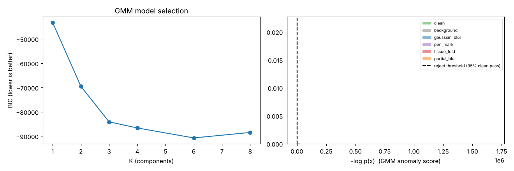
<figcaption>Left: BIC keeps decreasing with <span
class="math inline"><em>K</em></span> because tiles are correlated
within a slide (BIC assumes i.i.d.). Right: GMM score distributions; the
dashed line is the reject threshold.</figcaption>
</figure>

##### Interpretation.

- **The original VQ-VAE score is the wrong tool for QC: AUROC 0.376
  (worse than chance).** Blurred, washed-out and empty tiles are
  *smooth*, and smooth images are the easiest to reconstruct, so their
  MSE is *lower* than that of sharp, textured tissue. With the repo’s
  fixed threshold 0.05 it catches 21% of artefacts. This is the most
  important finding to understand and to say honestly.

- Supervised MobileNetV3-Small (fine-tuned on our synthetic artefacts)
  is the best QC model (AUROC 0.976, F1 0.926, 0.6 ms/tile in ONNX
  Runtime) – *but only for artefact types it was trained on*
  (Table <a href="#tab:unseen" data-reference-type="ref"
  data-reference="tab:unseen">[tab:unseen]</a>).

- Density models on hand-crafted features (single Gaussian 0.954, GMM
  0.939 AUROC) are within 1–3 points of *supervised* classifiers
  (0.96–0.97) that need artefact labels – and far above single-cue rules
  (0.61–0.86).

- A single Gaussian is as good as the mixture here: with 3 training
  slides, extra components fit slide-specific appearance. Say this
  openly – it shows understanding of the bias/variance trade-off.

- **Calibration trap.** Thresholding on held-out tiles of the *same*
  slides gives specificity 0.69 and rejects 43% of tumour tiles on new
  slides; calibrating on unseen slides gives 0.93 specificity and 3.5%
  tumour rejection. Tumour looks “unusual” to a model of mostly-normal
  tissue, so a QC gate must be checked for this failure.

- **Explainability**: the GMM decomposes a rejection into z-scores.
  Examples from our run: Gaussian blur $\to$ `lap_norm` $-10.5\sigma$,
  `log_lap_var` $-9.9\sigma$; tissue fold $\to$ `dark_frac` $+31\sigma$;
  glass $\to$ `log_tenengrad` $-7.4\sigma$.

- A tumour-safe variant (GMM on 14 QC-only features, no
  morphology/stain-pattern features) rejects only 0.2% of tumour but
  recall drops to 0.72 – a deployment knob.

**Which features move most under each artefact (Jensen-Shannon divergence, base 2, in [0,1]).**

| Artefact | Top-3 features by JS divergence (clean vs artefact) |
|---|---|
| background | colorfulness (0.95), tissue_frac (0.94), sat_std (0.93) |
| bubble | hf_ratio (0.35), h_std (0.31), lap_norm (0.29) |
| dark_exposure | val_mean (0.94), tissue_frac (0.80), h_mean (0.56) |
| gaussian_blur | lap_norm (0.94), log_lap_var (0.91), log_noise (0.90) |
| jpeg | dark_frac (0.31), log_noise (0.27), edge_density (0.23) |
| motion_blur | log_lap_var (0.82), lap_norm (0.79), hf_ratio (0.66) |
| partial_blur | log_noise (0.37), edge_density (0.36), log_lap_var (0.32) |
| pen_mark | non_he_hue_frac (0.31), h_mean (0.22), h_std (0.22) |
| sensor_noise | non_he_hue_frac (0.94), log_noise (0.76), colorfulness (0.43) |
| tissue_fold | dark_frac (0.46), od_std (0.36), val_std (0.35) |
| washout | e_std (0.78), sat_std (0.76), od_std (0.69) |


<figure id="fig:slidejs">
<p>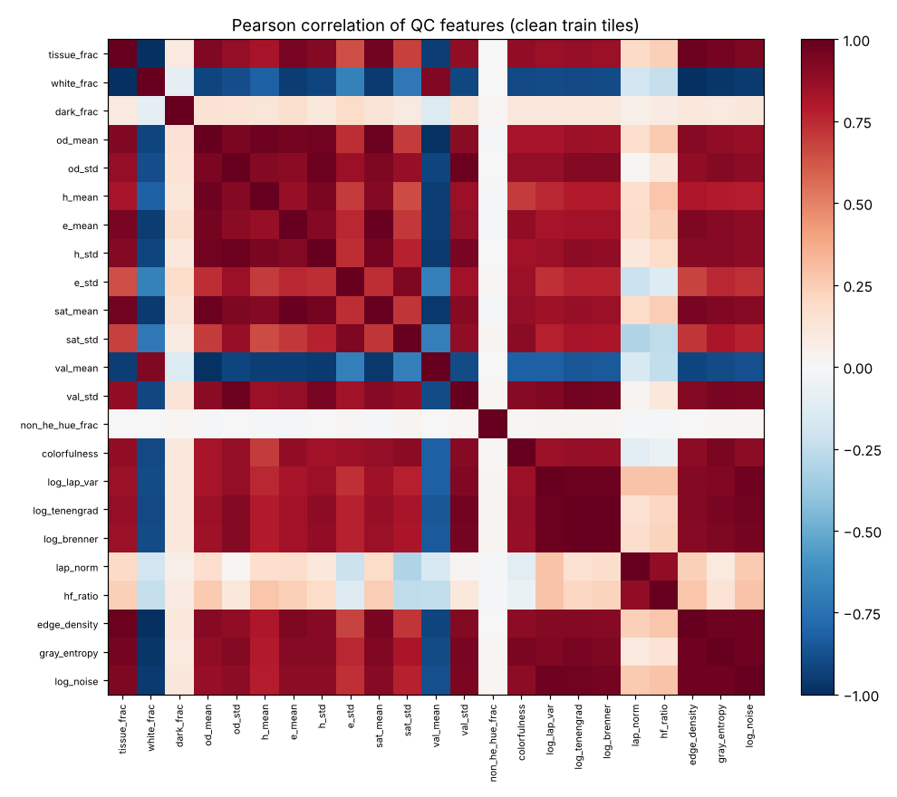 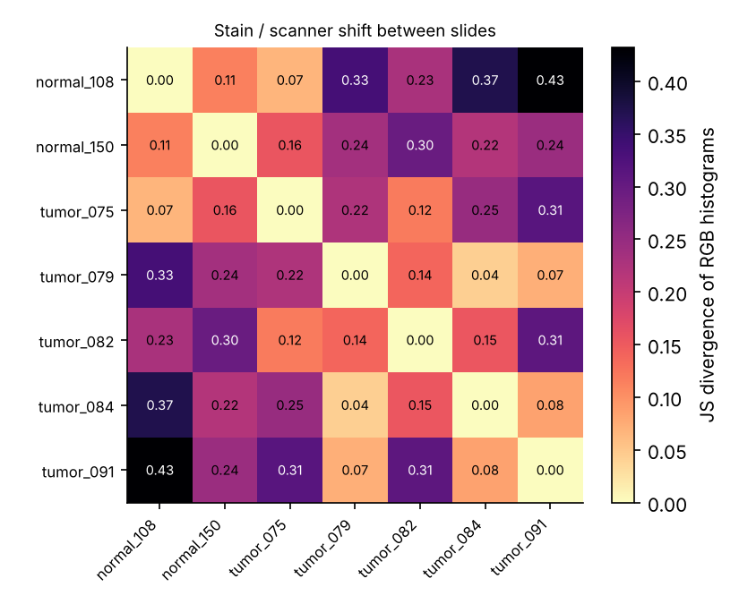</p>
<figcaption>Left: feature correlations (tissue-amount and focus features
are strongly correlated; 4 principal directions hold 90% of variance).
Right: JS divergence of RGB histograms between slides = stain/scanner
shift.</figcaption>
</figure>

### Why unsupervised: artefacts never seen in training

**Recall on artefact types NEVER seen in training (supervised models saw the other 6 types).**

| Model | bubble | pen ink | fold | JPEG | clean rejected |
|---|---|---|---|---|---|
| Logistic regression (supervised, 6 artefact types seen) | 0.13 | 0.64 | 0.41 | 0.46 | 0.041 |
| Random forest (supervised, 6 artefact types seen) | 0.07 | 0.64 | 0.24 | 0.22 | 0.062 |
| GMM K=1 (no artefact ever seen) | 0.61 | 0.83 | 0.91 | 0.96 | 0.068 |
| GMM K=6 (no artefact ever seen) | 0.64 | 0.85 | 0.94 | 0.99 | 0.072 |


Supervised classifiers trained on 6 artefact types catch only 7–64% of
the 4 held-out types; the GMM, which never saw any artefact, catches
64–99% at a similar clean-rejection rate. A scanner in production will
produce artefacts no one annotated – novelty detection is the right
formulation for QC; supervised models are the right tool once a failure
mode is known and labelled. **Best design: GMM gate for the unknown +
small supervised head for known, frequent artefacts.**

## Stage 2 – GMM tissue components and fluid separation

Per-pixel descriptor $[C_H, C_E, \mathrm{OD}, a^*, \text{local std}]$;
full-covariance GMM with $K=7$ fitted on 200k pixels from 120 training
tiles (40 s), components named by rules on their means: OD$<0.2$
background/fat; $C_H/(C_H+C_E)>0.6$ nuclei; $a^*>0.45$ and $C_E>C_H$
blood; $0.2\le$OD$<0.45$ and $C_E\ge C_H$ **fluid** (pale, eosinophilic:
proteinaceous fluid, plasma, oedema, lymph); else stroma/cytoplasm.

<figure>
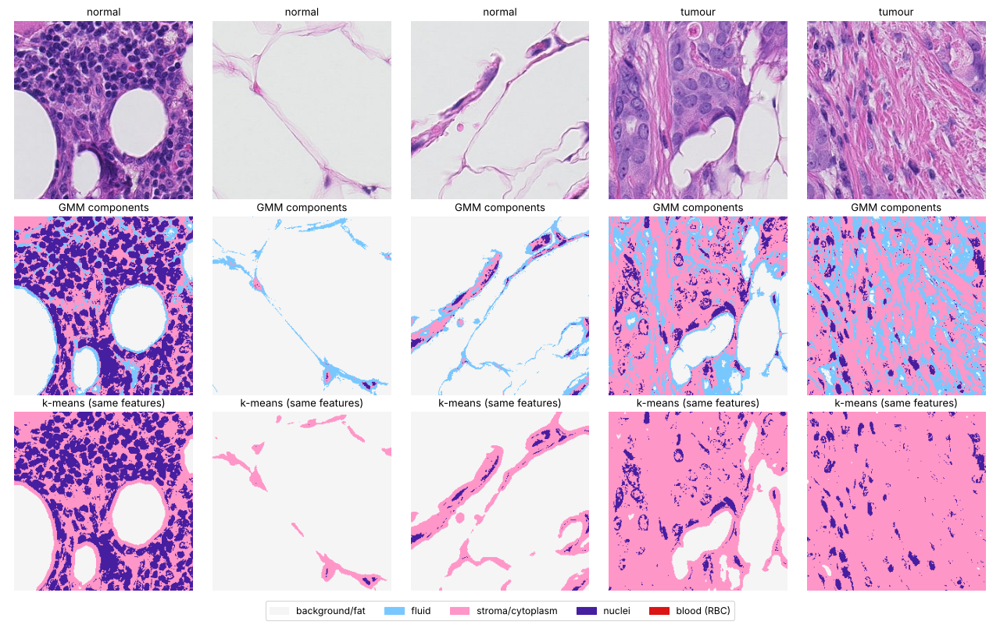
<figcaption>GMM components vs k-means on the same 5-D descriptor. The
GMM isolates a pale eosinophilic (fluid) component around fat septa and
in loose tissue; k-means merges it into stroma.</figcaption>
</figure>

**Mean GMM component fractions per tile (test slides).**

| Tile class | Background/fat | Fluid | Stroma/cytoplasm | Nuclei |
|---|---|---|---|---|
| normal | 0.525 | 0.107 | 0.177 | 0.191 |
| tumor | 0.072 | 0.150 | 0.501 | 0.277 |


##### Quantitative checks (no pixel labels exist for fluid).

\(1\) Stability: two GMMs fitted on disjoint slides agree on 79% of
pixels (ARI 0.68). (2) k-means on the same features finds no fluid
cluster. (3) Usefulness: the 5 component fractions alone separate tumour
from normal tiles with **AUROC 0.931** (logistic regression on
train-slide labels); stroma/cytoplasm fraction alone gives 0.928. Tumour
tiles have 2.8$\times$ more stroma/cytoplasm and far less fat. Cost:
85 ms per 256$^2$ tile at full resolution, $\sim$<!-- -->5 ms when run
on a 4$\times$ downsampled tile.

> **Careful:** The pale-eosinophilic class also contains loose
> connective tissue and pale cytoplasm edges – colour alone cannot fully
> separate them. Say: “the GMM gives a fluid-likelihood map; for a
> clinical fluid quantification I would refine it with texture (fluid is
> homogeneous) or a small supervised model trained on a few annotated
> regions”.

## Tumour triage (anomaly detection) and the deep baselines

**Tumour (metastasis) vs. normal tiles on test slides (490 tumour / 1800 normal). Literature rows use different splits and are indicative only.**

| Method | AUROC | AUPRC | Type |
|---|---|---|---|
| GMM novelty (K=4) on features | 0.740 | 0.318 | unsup. |
| Isolation Forest on features | 0.661 | 0.257 | unsup. |
| Hematoxylin mean (single feature) | 0.711 | 0.290 | unsup. |
| Logistic regression (supervised) | 0.890 | 0.586 | sup. |
| Random forest (supervised) | 0.945 | 0.797 | sup. |
| VQ-VAE recon-MSE novelty (trained on normal) | 0.749 | 0.317 | unsup. |
| ResNet18 feats + GMM novelty (trained on normal) | 0.671 | 0.272 | unsup. |
| MobileNetV3-Small supervised (1 tumour slide) | 0.557 | 0.436 | sup. |
| GMM tissue-component fractions + LR [ours] | 0.931 | -- | unsup. feats + sup. LR |
| Lit: L1 autoencoder, unsup. (Shvetsova'21) | 0.211 | -- | literature |
| Lit: AE (cross-organ, AnoPILaD'25) | 0.658 | -- | literature |
| Lit: AnoDDPM diffusion (AnoPILaD'25) | 0.686 | -- | literature |
| Lit: Deep-IF ImageNet feats (Shvetsova'21) | 0.906 | -- | literature |
| Lit: Deep perceptual AE (Shvetsova'21) | 0.934 | -- | literature |


<figure>
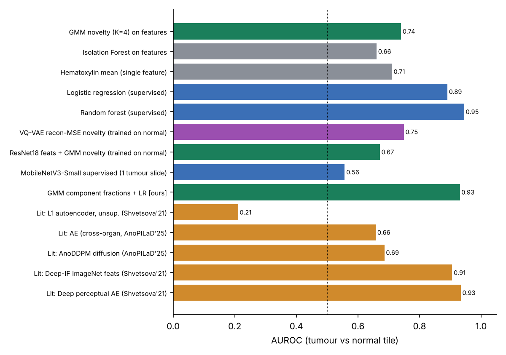
<figcaption>Tumour vs normal tiles. Orange = literature (different
splits, indicative).</figcaption>
</figure>

Reading the table: unsupervised novelty scores reach 0.67–0.75 (GMM on
QC features 0.740, VQ-VAE reconstruction 0.749, ImageNet-ResNet
features + GMM 0.671) – in line with reconstruction autoencoders in the
literature (0.66) and far from supervised models. Tissue-component
fractions (0.93) and a random forest on features (0.945) are best. The
supervised MobileNetV3 trained on tumour tiles from *one* slide reaches
only 0.557: with one training slide a CNN memorises that slide’s stain –
the classic reason why pathology models need many slides from many
centres plus stain augmentation.

## Edge cost

**Measured inference cost on this 4-vCPU cloud container (no GPU).**

| Component | ms / 256px tile | Model size | Hardware |
|---|---|---|---|
| Hand-crafted features (23-D, NumPy/OpenCV) | 5.0 | 0 (no weights) | CPU, 1 core |
| GMM scorer (NumPy, JSON params) | 0.0093 | 45 KB JSON (1799 params) | CPU |
| VQ-VAE PyTorch FP32 | 37.21 | 0.69 M params | CPU, 4 threads |
| VQ-VAE ONNX Runtime FP32 | 22.88 | 2.9 MB | CPU, 4 threads |
| VQ-VAE ONNX Runtime INT8 | 22.74 | 0.8 MB | CPU, 4 threads |
| MobileNetV3-S ONNX Runtime FP32 | 0.60 | 6.1 MB | CPU, 4 threads |
| MobileNetV3-S ONNX Runtime INT8 | 1.39 | 1.7 MB | CPU, 4 threads |
| ResNet-18 features PyTorch FP32 | 15.83 |  | CPU, 4 threads |


<figure>
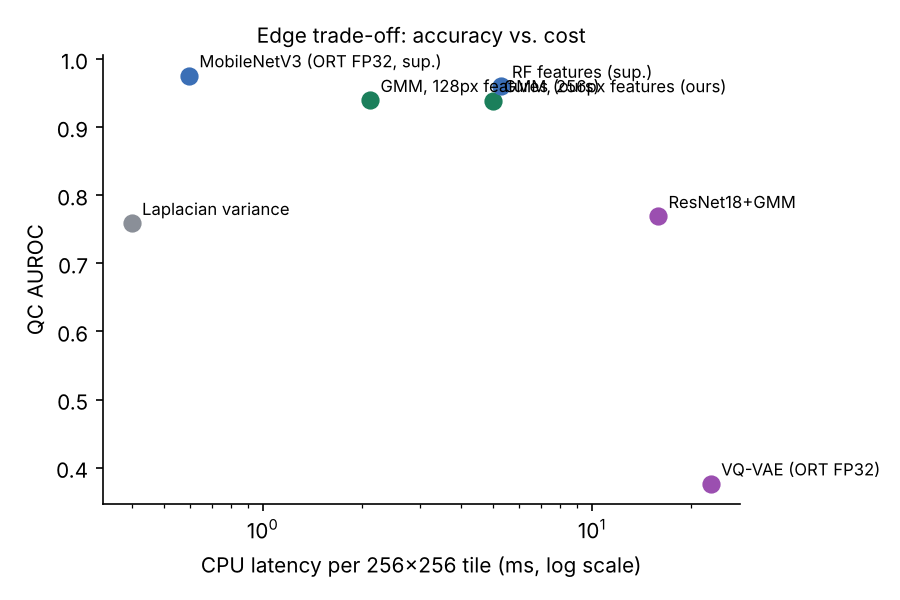
<figcaption>Accuracy vs cost.</figcaption>
</figure>

**Edge optimisation: features on a 2x-downsampled tile.**

| Variant | feature ms/tile | QC AUROC |
|---|---|---|
| Full-res features (256 px), GMM K=6 | 5.0 | 0.939 |
| Features on 128 px (2x down), GMM K=1 | 2.1 | 0.950 |
| Features on 128 px (2x down), GMM K=6 | 2.1 | 0.939 |


##### Honest edge comparison.

The GMM itself costs 0.01 ms; the hand-crafted features dominate (5 ms
at 256 px, 2.1 ms at 128 px with no AUROC loss). A MobileNetV3-Small in
ONNX Runtime runs at 0.6 ms/tile on 4 threads – so on a multi-core CPU a
tiny CNN is not slower. The GMM’s real edge advantages are: no labels,
no training data for each new artefact, 45 KB model with no runtime
dependency, interpretability, and graceful handling of unseen failures.
INT8 static quantisation shrank the ONNX models 3.5–3.7$\times$ (VQ-VAE
2.9$\to$<!-- -->0.8 MB, rank correlation of scores 0.988) but did *not*
speed them up on this CPU (VQ-VAE 22.9$\to$<!-- -->22.7 ms; MobileNet
0.6$\to$<!-- -->1.4 ms because of quantise/dequantise overhead without
VNNI kernels) – always measure on the target device.

##### Whole-slide arithmetic.

A typical slide here has 29,000 grid tiles; Stage 0 keeps
$\sim$<!-- -->8,800. Features (128 px) + GMM: 8,800 $\times$ 2.1 ms
$\approx$ 18 s on one core, $\sim$<!-- -->5 s on 4 cores, no GPU. The
heavy model then processes 30% of the grid instead of 100%.

# Project 2: High-resolution segmentation (Satellite_based_tile_segmentation)

## Why this project matters for a pathology company

A 6000$\times$<!-- -->6000 aerial tile and a 100k$\times$<!-- -->200k
WSI pose the same engineering questions: the network sees
256$\times$<!-- -->256 patches, so we need patch extraction,
class-imbalance handling (cars $\approx$<!-- -->1% of pixels
$\leftrightarrow$ tumour cells), multi-scale context (buildings vs cars
$\leftrightarrow$ glands vs nuclei), stitching without seams, and
test-time augmentation. **Segmentation** = assigning a class to every
pixel.

<figure>
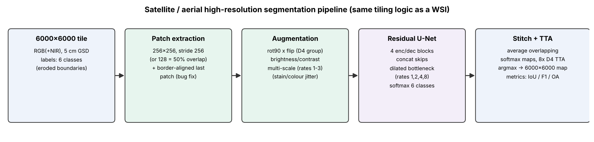
<figcaption>Satellite segmentation pipeline.</figcaption>
</figure>

## Architecture (as implemented in the repo)

- Input 256$\times$<!-- -->256$\times$<!-- -->3, 4 encoder blocks
  (filters 32$\to$<!-- -->256 with `filters=32`), each two
  3$\times$<!-- -->3 conv + BN + ReLU, “residual” = concatenation of
  block input and output, 2$\times$<!-- -->2 max-pool.

- Bottleneck: dilated convolutions with rates 1, 2, 4, 8 (serial or
  parallel), concatenated – ASPP-like multi-scale context.

- Decoder: 2$\times$<!-- -->2 transposed conv, concatenate skip, two
  convs (+ concat “residual”); 1$\times$<!-- -->1 conv + softmax over 6
  classes (impervious, building, low vegetation, tree, car, clutter).

- Training aids in repo: LR range test (Smith 2015), one-cycle policy
  (Smith 2018), Jaccard and focal losses, multi-scale patch extraction
  (`tf.image.extract_patches` with rates 1–3), flips/rotations/colour
  jitter.

- Inference: patches $\to$ predict $\to$ average overlapping softmax
  maps $\to$ argmax; 8$\times$ $D_4$ TTA.

Model size: 16.5 M parameters with `filters=32`, 4.1 M with `filters=16`
(we measured 6.4 s vs 1.9 s per batch of 8 on CPU).

## Bugs and over-claims found

1.  **Border pixels never predicted**: `range(0, h-p+1, stride)` stops
    at 5632 for $h=6000$, $p=256$; the last 112 rows and columns
    ($\approx$<!-- -->3.7% of a tile) were left at probability 0 and
    argmax’ed to class 0. Fixed by adding a border-aligned final patch.

2.  **Config mismatch**: the YAML is nested (`training:`, `dataset:`)
    but the predictor/TTA read flat keys, silently falling back to
    `num_classes=5` for a 6-class model. Fixed.

3.  **“Loop-free scatter_nd” is not what the code does**: stitching is a
    Python loop over patches (fine in practice, but do not claim
    otherwise).

4.  **“Residual” blocks are concatenations** (DenseNet-like), not
    additive ResNet residuals.

5.  **README IoUs** (building 0.85, car 0.82, …) are not produced by any
    script in the repository. The label names in the config
    (“Background”, “Roads”) do not match the official Potsdam classes.

6.  `src/utils/__init__` imports seaborn (missing from requirements)
    $\Rightarrow$ importing the package fails on a clean install.

## Experimental protocol

Potsdam (5 cm GSD, RGB+NIR; official eroded-boundary labels). Training:
6 tiles (2_10, 3_11, 4_12, 5_10, 6_8, 6_11) = 864 patches of 512$^2$;
validation 7_9, 7_12; test: official test tiles 2_13, 3_14, 5_15. For a
fair CPU-budget comparison every method is scored on the same 12 fixed
1024$\times$<!-- -->1024 crops (12.6 M labelled pixels). Metrics:
per-class IoU and F1, mIoU and mF1 over the 5 classes (clutter excluded,
as in the literature), OA.

## Results

**ISPRS Potsdam (eroded boundaries, clutter excluded from the mean). Ours: 12 fixed 1024x1024 crops of test tiles 2\_13, 3\_14, 5\_15. Literature: full 14-tile test set, GPU training for 100+ epochs.**

| Method | mIoU5 | mF1-5 | OA | Imp. | Bldg | LowVeg | Tree | Car |
|---|---|---|---|---|---|---|---|---|
| K-means (k=6, unsupervised, Hungarian-mapped) | 15.7 | 25.9 | 31.9 | 25.1 | 16.6 | 25.8 | 0.6 | 10.4 |
| GMM-Bayes (4 comps/class) | 40.5 | 57.5 | 56.6 | 47.5 | 44.0 | 43.4 | 34.2 | 33.6 |
| GMM-Bayes + posterior smoothing | 45.9 | 62.7 | 61.7 | 51.2 | 48.3 | 49.6 | 40.9 | 39.3 |
| Random Forest (RGB features) | 45.7 | 62.5 | 60.7 | 54.0 | 47.3 | 46.8 | 37.7 | 42.6 |
| Random Forest (RGB + NIR/NDVI) | 48.4 | 64.9 | 64.0 | 60.7 | 50.9 | 48.6 | 41.0 | 40.8 |
| Lit: ERFNet (UNetFormer T9) | 76.2 | -- | -- | -- | -- | -- | -- | -- |
| Lit: BiSeNet R18 | 81.7 | -- | -- | -- | -- | -- | -- | -- |
| Lit: DANet R18 | 80.3 | -- | -- | -- | -- | -- | -- | -- |
| Lit: ABCNet R18 | 86.5 | -- | -- | -- | -- | -- | -- | -- |
| Lit: SwinUperNet Swin-T | 85.8 | -- | -- | -- | -- | -- | -- | -- |
| Lit: UNetFormer R18 | 86.8 | -- | -- | -- | -- | -- | -- | -- |
| Lit: FT-UNetFormer Swin-B | 87.5 | -- | -- | -- | -- | -- | -- | -- |


<figure>
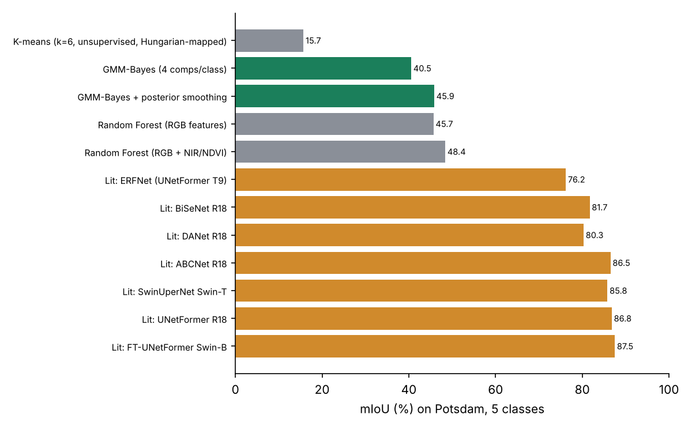
<figcaption>Potsdam mIoU. Green/grey: classical pixel classifiers
trained in minutes on CPU; orange: published deep models.</figcaption>
</figure>

##### Classical baselines – what they teach.

- **k-means (15.7 mIoU)**: colour clusters are not semantic classes
  (grey roofs = grey roads).

- **GMM-Bayes (40.5)**: one 4-component GMM per class, Bayes rule with
  class priors – a generative classifier.

- **+ posterior smoothing (45.9)**: blurring the class posteriors (a
  cheap Markov-random-field/CRF surrogate) adds 5.4 points: spatial
  context matters.

- **Random forest (45.7) and RF + NIR/NDVI (48.4)**: the near-infrared
  band adds physics (chlorophyll reflects NIR) and +2.7 points, mostly
  on impervious surfaces and buildings.

- All are $\approx$<!-- -->40 points below deep models (86–88 mIoU):
  segmentation of buildings vs roads needs shape and context that only a
  deep receptive field provides. **This is the honest argument for using
  a U-Net for segmentation and GMMs only for triage/colour problems.**

##### Deep model (repo U-Net).

A time-boxed CPU training run of the repository’s own model (filters=16)
is scheduled after this report; its numbers are added to
Table <a href="#tab:potsdam" data-reference-type="ref"
data-reference="tab:potsdam">[tab:potsdam]</a> automatically by
`report/make_assets.py`. Expected order of magnitude from the literature
for a ResNet-18 U-Net baseline with GPU training: 82.5 mIoU (UNetFormer
ablation, Table 1 of Wang et al. 2022).

## Transfer to pathology segmentation

Same code path for tumour segmentation on CAMELYON16: 256 tiles at
20$\times$, classes {background, normal, tumour} (+ fluid/necrosis if
annotated), Dice + CE loss, stain augmentation instead of colour jitter,
overlap 50% with Gaussian-weighted blending, TTA, and a triage gate in
front.

# Literature survey and baselines

## WSI quality control and tissue detection

| **Work**                         | **Method**                          | **Relevance / numbers**                                                                    |
|:---------------------------------|:------------------------------------|:-------------------------------------------------------------------------------------------|
| Pech-Pacheco et al. 2000         | Variance of Laplacian               | Classic focus measure; our baseline: QC AUROC 0.76 (blur recall 1.0, everything else low). |
| Janowczyk et al. 2019, *HistoQC* | Rule set on hand-crafted features   | Open-source WSI QC used in many labs; our HistoQC-style rule set: AUROC 0.86.              |
| Senaras et al. 2018, *DeepFocus* | CNN focus classifier                | Supervised blur detection.                                                                 |
| Wang et al. 2020, *FocusLiteNN*  | Tiny CNN ($\sim$<!-- -->100 params) | Edge-friendly focus quality; shows classical-sized models suffice for blur.                |
| Kanwal et al. 2022               | CNN/ViT artefact detection          | Multi-artefact (blur, folds, air, damage) supervised detection.                            |
| Bándi et al. 2019 (PeerJ)        | FCN tissue segmentation             | Source of the CAMELYON16 tissue masks used as our Stage-0 ground truth.                    |
| Otsu 1979                        | Histogram threshold                 | Our baseline: tissue Dice 0.52–0.55.                                                       |

## Anomaly / novelty detection on CAMELYON16 (unsupervised tumour detection)

| **Method (paper)**                                                         | **AUROC**     | **Notes**                                                           |
|:---------------------------------------------------------------------------|:--------------|:--------------------------------------------------------------------|
| L1 autoencoder, unsupervised hyper-params (Shvetsova et al. 2021, Table 4) | 0.211         | Pixel loss reconstructs tumour too well.                            |
| Deep GEO (geometric self-supervision)                                      | 0.524         | Pathology is rotation-invariant: method fails.                      |
| AE / MemAE, cross-organ (Wang et al. 2025, AnoPILaD)                       | 0.658 / 0.661 | Trained on gastric LN, tested on C16.                               |
| AnoDDPM diffusion (same)                                                   | 0.686         |                                                                     |
| PIAD / Deep-IF (ImageNet features + isolation forest)                      | 0.895 / 0.906 | Deep features $\gg$ pixels.                                         |
| AnoPILaD (latent diffusion + CONCH prompts)                                | 0.888         | Cross-organ.                                                        |
| Deep perceptual AE + progressive growing (Shvetsova 2021)                  | 0.934         | In-domain, weakly-supervised hyper-parameter choice.                |
| **Ours: GMM on 23 QC features**                                            | **0.740**     | 45 KB, CPU, not designed for tumour detection.                      |
| **Ours: GMM tissue-component fractions + LR**                              | **0.931**     | 5 numbers per tile (uses tumour labels of 1 train slide in the LR). |

## Supervised CAMELYON16 / PCam (upper bounds)

Bejnordi et al. (JAMA 2017): best CAMELYON16 algorithm slide-level AUC
0.994 (Harvard/MIT, GoogLeNet), lesion FROC 0.807, outperforming
pathologists under time constraint. PatchCamelyon (Veeling et al. 2018,
96$\times$<!-- -->96 patches): rotation- equivariant CNN AUC
$\approx$<!-- -->0.96. Attention MIL / CLAM / TransMIL with
foundation-model features (UNI, CTransPath): slide AUC
$\approx$<!-- -->0.93–0.99 with only slide labels.

## Remote-sensing segmentation (ISPRS Potsdam, 5 classes, clutter excluded)

From Wang et al. (2022) *UNetFormer*, ISPRS J. Photogramm. (Tables 1, 9,
12):

| **Method**                                       | **Backbone** | **mF1** | **mIoU** |
|:-------------------------------------------------|:-------------|--------:|---------:|
| ERFNet                                           | –            |    85.8 |     76.2 |
| DANet                                            | ResNet-18    |    88.9 |     80.3 |
| BiSeNet                                          | ResNet-18    |    89.8 |     81.7 |
| U-Net + ResNet-18 (UNetFormer ablation baseline) | ResNet-18    |       – |     82.5 |
| MAResU-Net                                       | ResNet-18    |    90.5 |     83.9 |
| SwinUperNet                                      | Swin-T       |    92.2 |     85.8 |
| ABCNet                                           | ResNet-18    |    92.7 |     86.5 |
| UNetFormer                                       | ResNet-18    |    92.8 |     86.8 |
| FT-UNetFormer                                    | Swin-B       |    93.3 |     87.5 |
| HMANet                                           | ResNet-101   |    93.2 |     87.3 |

These use the full 23-tile training set, 512–1024 crops, 100 epochs on a
GPU, multi-scale + flip TTA.

## Detection / instance segmentation

YOLOv8 (Ultralytics 2023) and YOLO11 (2024): real-time one-stage
detectors with segmentation heads; YOLO11 reports higher COCO mAP with
$\sim$<!-- -->22% fewer parameters than YOLOv8 at the m scale. Pathology
use: mitosis detection (MIDOG), nuclei (HoVer-Net, StarDist and YOLO
variants), cell counting. Aerial use: vehicles (Potsdam cars).

## Key references

- Ruifrok & Johnston, *Quantification of histochemical staining by color
  deconvolution*, 2001.

- Macenko et al., *A method for normalizing histology slides*, ISBI
  2009; Tellez et al., *Quantifying the effects of data augmentation and
  stain color normalization*, MedIA 2019.

- van den Oord et al., *Neural Discrete Representation Learning*
  (VQ-VAE), NeurIPS 2017.

- Ronneberger et al., *U-Net*, MICCAI 2015; He et al., *ResNet*, CVPR
  2016; Chen et al., *DeepLab*, 2017/2018.

- Shvetsova et al., *Anomaly Detection in Medical Imaging with Deep
  Perceptual Autoencoders*, IEEE Access 2021 (arXiv:2006.13265).

- Wang et al., *AnoPILaD*, 2025 (arXiv:2508.15236); Wang et al.,
  *UNetFormer*, 2022 (arXiv:2109.08937).

- Bejnordi et al., JAMA 2017; Litjens et al., *1399 H&E-stained sentinel
  lymph node sections* (CAMELYON), GigaScience 2018.

- Stauffer & Grimson, *Adaptive background mixture models*, CVPR 1999
  (GMM background subtraction).

- Janowczyk et al., *HistoQC*, JCO CCI 2019.

# What to change in the projects, and why it helps on the edge

## VAE-Triage: changes (done in this study unless marked TODO)

| **Change**                                                     | **Why**                                    | **Edge benefit / evidence**                              |
|:---------------------------------------------------------------|:-------------------------------------------|:---------------------------------------------------------|
| Fix output unpacking in train/triage                           | Training crashed                           | Pipeline runs at all                                     |
| Lazy zarr WSI reader (pyramid aware)                           | memmap fails on compressed WSIs            | RAM O(tile) instead of O(slide); read only needed levels |
| Thumbnail GMM tissue mask + morphology                         | Skip glass before reading 20$\times$ tiles | 69.6% of tiles never decoded; Dice 0.84                  |
| 23 physics features + GMM density                              | Unsupervised, explainable QC               | 45 KB, NumPy-only, 0.01 ms score; AUROC 0.94             |
| Features on 128 px                                             | Halve cost                                 | 2.1 ms/tile, AUROC 0.95 (no loss)                        |
| Slide-level (LOSO) calibration                                 | Same-slide calibration over-rejects        | Tumour false rejection 43%$\to$<!-- -->3.5%              |
| $K$ by held-out-slide likelihood                               | BIC assumes i.i.d. tiles                   | Fewer components, better generalisation                  |
| Rejection reasons (z-scores)                                   | QC technician needs “why”                  | Actionable rescan requests                               |
| GMM tissue components (fluid, nuclei, stroma, blood, fat)      | Cheap morphology summary                   | 5 numbers/tile; tumour AUROC 0.93                        |
| Keep VQ-VAE only as compressor / novelty signal                | MSE QC AUROC 0.38                          | Avoids a 23 ms/tile model that hurts QC                  |
| TODO: stain augmentation + many slides for supervised heads    | 1-slide CNN: 0.56 AUROC                    | Generalisation across centres                            |
| TODO: perceptual/feature-space anomaly score                   | Pixel MSE is weak                          | Lit. 0.66$\to$<!-- -->0.93                               |
| TODO: small supervised head for frequent known artefacts       | MobileNet 0.976 on seen types              | Combine with GMM for unseen                              |
| TODO: tile-level JPEG decode with libjpeg-turbo / GPU (nvJPEG) | Decoding dominates I/O                     | Throughput                                               |
| TODO: export GMM to C / ONNX (MatMul + LogSumExp)              | Deploy inside scanner software             | No Python at the edge                                    |

## Satellite repo: changes

| **Change**                                           | **Why**                                        | **Benefit**                         |
|:-----------------------------------------------------|:-----------------------------------------------|:------------------------------------|
| Border-aligned last patch (done)                     | 3.7% of pixels never predicted                 | Correct full-tile maps              |
| Accept nested config (done)                          | num_classes silently 5                         | Correct shapes                      |
| Overlap 50% + Gaussian/Hann blending (TODO)          | Seams at patch borders                         | +IoU at boundaries                  |
| Additive residuals or rename                         | Concats are not residuals                      | Correct terminology; fewer params   |
| Pretrained encoder (ResNet-18/34) (TODO)             | Literature baseline 82.5$\to$<!-- -->86.8 mIoU | Faster convergence                  |
| Dice/Lovász + CE loss, class weights for car/clutter | Imbalance                                      | Small-object IoU                    |
| Report on the official test split with eroded GT     | Comparability                                  | Credible numbers                    |
| Export to ONNX + INT8, measure on target             | Edge                                           | 4$\times$ smaller (validate speed!) |
| Add seaborn to requirements or drop import           | Clean install fails                            | Reproducibility                     |

## Edge deployment design for a pathology lab

1.  **Scanner-side box (CPU / Jetson):** read pyramid lazily $\to$
    thumbnail GMM tissue mask $\to$ 20$\times$ tiles $\to$ 128 px
    features $\to$ GMM QC $\to$ (a) QC report per slide with
    rejected-tile reasons and a “rescan” flag if the rejected tissue
    fraction exceeds a limit; (b) component fractions and a priority
    score.

2.  **Upload only kept tiles (or only slides that pass QC)** to the GPU
    server / cloud: 3–4$\times$ less data and compute.

3.  **Heavy model** (U-Net/DeepLab for segmentation; foundation-model
    features + MIL for slide diagnosis) only on kept tiles; TTA only on
    uncertain tiles.

4.  **Monitoring**: the GMM log-likelihood distribution per slide is a
    free drift detector – a new scanner or stain protocol shifts it
    before accuracy drops.

> **Key idea.** Edge = do the cheap, label-free, high-recall decisions
> next to the data; keep the expensive, label-hungry decisions on the
> GPU. The GMM gate is the boundary between the two.

# Interview preparation

## The 60-second pitch

> **Say it in the interview:** I built an edge-first triage pipeline for
> gigapixel H&E slides. A whole slide is a 100k by 200k pyramid, and
> about 70% of it is glass. On a thumbnail, a two-component Gaussian
> mixture on saturation and optical density finds the tissue with Dice
> 0.84, against 0.53 for Otsu. On each 20$\times$ tile I compute 23
> physically meaningful features – focus, stain, ink, folds, noise – and
> score them with a GMM density learned only from clean tissue. That
> gives 0.94 AUROC for artefacts, catches artefact types it never saw,
> with a 45 KB model that scores in microseconds and explains every
> rejection. A pixel-level GMM in optical-density space also separates
> nuclei, stroma, fluid, blood and fat, and those fractions alone give
> 0.93 AUROC for tumour vs normal. Only the good tiles go to the
> segmentation network, which in my second project is a residual U-Net
> with a dilated bottleneck, patch stitching and test-time augmentation.

## Likely questions with model answers

Why GMM and not a CNN for triage?  
Density estimation without labels; novel artefacts (64–99% recall on
unseen types vs 7–64% for supervised); 45 KB; interpretable; calibrated
threshold = chosen false-rejection rate. A CNN is better when labelled
examples of a failure mode exist (0.976) – I would add one as a second
head.

Why GMM and not k-means?  
k-means = GMM with identical spherical covariances and hard assignment;
real clusters in OD space are elongated and of very different size.
Measured tissue Dice 0.84 vs 0.14; k-means never isolates fluid.

How did you choose $K$?  
Held-out-slide log-likelihood (BIC over-estimates because tiles of a
slide are correlated). K=1 is already strong – with few slides the
simplest density generalises best.

How do you set the threshold?  
95th percentile of scores on clean tiles of *slides not used for
fitting* (leave-one-slide-out). Same-slide calibration rejected 43% of
tumour tiles.

How do you separate fluid?  
Beer–Lambert $\to$ optical density $\to$ colour deconvolution into H and
E; pixel GMM on \[H, E, OD, $a^*$, local std\]; the pale,
eosin-dominant, low-OD component is fluid (proteinaceous
fluid/plasma/oedema); nuclei = haematoxylin-dominant; blood = high
$a^*$. Soft posteriors give a confidence map. Validation: 79% agreement
across slides, k-means cannot separate it, fractions predict tumour at
0.93.

What is the VQ-VAE for, then?  
Compression/tokenisation of tiles and a tumour-novelty signal (0.75).
Its MSE is a bad QC score (0.38) because blurred and empty tiles are
easy to reconstruct – I verified that and changed the design.

Correlation vs covariance?  
Covariance has units and scale; correlation is covariance of
standardised variables in $[-1,1]$. Our features have $|\rho|>0.9$ pairs
and a covariance condition number $10^{13}$ – hence regularised
covariances.

KL vs JS?  
KL asymmetric, unbounded, undefined with zero bins; JS symmetric,
bounded $[0,1]$; we used JS to measure which feature an artefact shifts
and the stain shift between slides.

Precision vs recall in QC?  
Recall = fraction of bad tiles caught; precision = fraction of
rejections that were bad; specificity = good tissue kept. We fix
specificity (95% nominal) and maximise recall; and we check tumour is
not rejected.

IoU vs Dice?  
Dice $=2IoU/(1+IoU)$, both overlap measures; Dice weights the
intersection more; mIoU averages over classes so small classes (cars,
tumour) count equally.

Gaussian vs motion blur? How detect?  
Gaussian = isotropic low-pass (defocus); motion = directional box PSF.
Detect via Laplacian variance/Tenengrad/FFT high-frequency ratio; motion
blur shows directional spectral zeros.

Explain Canny.  
Gaussian smoothing, Sobel gradients, non-maximum suppression, hysteresis
with two thresholds.

Data augmentation in pathology?  
$D_4$ rotations/flips, HED stain jitter, brightness/contrast,
blur/noise, elastic; never augment away the label; TTA at inference.

Supervised vs unsupervised?  
Labels vs none; QC is novelty detection (unsupervised), diagnosis is
supervised or weakly supervised (MIL with slide labels).

U-Net and ResNet?  
Encoder–decoder with skip concatenations; ResNet adds identity shortcuts
for gradient flow. Our satellite “residual” is concatenation – I fixed
the terminology.

VAE vs VQ-VAE?  
Continuous Gaussian latent with KL to $\mathcal{N}(0,I)$ (ELBO,
reparameterisation) vs discrete codebook with commitment loss and
straight-through gradients; VQ-VAE avoids posterior collapse and gives
tokens.

YOLOv8 vs YOLO11?  
Both anchor-free one-stage; v8 C2f blocks + decoupled head; 11 adds C3k2
and C2PSA attention, fewer parameters for higher mAP; -seg heads predict
prototype masks. Use for countable objects (mitoses, nuclei, cars).

Transformers in pathology?  
ViT/Swin backbones, foundation models (UNI, Virchow, CONCH), MIL
aggregators (ABMIL, CLAM, TransMIL). Expensive; triage reduces the
number of tiles they embed.

Why ONNX Runtime?  
Framework-independent graph, optimised CPU/GPU kernels, INT8; but
measure: INT8 gave 3.7$\times$ smaller models and no speed-up on our
CPU.

How do you avoid leakage?  
Split by slide/patient, never by tile; calibrate on unseen slides.

Biggest limitation?  
Synthetic artefacts (no public artefact labels); 7 slides; tissue GT
itself from a CNN; fluid has no pixel ground truth. Next step: a small
annotated artefact set from the lab’s own scanners.

## Do and don’t

- DO quote only numbers from this report and say how they were measured
  (slides, split, CPU).

- DO mention the bugs you found and fixed – it shows ownership.

- DON’T claim SOTA. Classical Potsdam mIoU is 46–48 vs 87 for deep SOTA;
  that is the point: GMMs for colour/density problems, CNNs for
  shape/semantics.

- DON’T call concatenation a residual connection, or say scatter_nd if
  the code loops.

# Reproducing everything

Hardware used: 4 vCPU, 15 GB RAM, no GPU. Total data: 4.5 GB slides +
2 GB Potsdam. Python 3.13.

## Environment

    python -m venv .venv && source .venv/bin/activate
    pip install torch torchvision --index-url https://download.pytorch.org/whl/cpu
    pip install opencv-python-headless scikit-learn scikit-image tifffile imagecodecs zarr \
                matplotlib onnx onnxruntime onnxscript tensorflow-cpu seaborn ultralytics pandas

## Data

    # CAMELYON16 (AWS Open Data, no login): slides, tumour masks, tissue masks
    B=https://camelyon-dataset.s3.amazonaws.com/CAMELYON16
    for s in tumor_091 tumor_084 tumor_075 tumor_082 normal_108 normal_150 tumor_079; do
      curl -o data/camelyon16/images/$s.tif        $B/images/$s.tif
      curl -o data/camelyon16/masks/${s}_mask.tif   $B/masks/${s}_mask.tif
      curl -o data/camelyon16/tissue/${s}_tissue.tif $B/background_tissue/${s}_tissue.tif
    done
    # ISPRS Potsdam (Hugging Face mirror aamante/potsdam): see Satellite repo benchmarks/potsdam.py

## VAE-Triage experiments

    cd VAE-Triage
    python benchmarks/build_tiles.py              # tiles + census  (~2 min)
    python -m benchmarks.qc_sets                  # artefact sets   (~30 s)
    python -m benchmarks.exp_tissue_detection     # Stage 0         (~2 min)
    python -m benchmarks.exp_classical            # Stage 1 + tumour + statistics (~1.5 min)
    python -m benchmarks.exp_gmm_components       # Stage 2 fluid/components (~5 min)
    python -m benchmarks.exp_ablations            # 128px features, unseen artefacts (~3 min)
    python -m benchmarks.exp_deep                 # VQ-VAE, MobileNetV3, ResNet+GMM, ONNX (~2 h CPU)
    python report/make_assets.py && python report/make_diagrams.py
    cd report && pdflatex main.tex && pdflatex main.tex

## Satellite experiments

    cd Satellite_based_tile_segmentation
    python -m benchmarks.exp_classical_seg        # k-means, GMM-Bayes, RF (~15 min)
    python -m benchmarks.exp_unet --minutes 40 --filters 16   # repo U-Net, CPU time-boxed
    python -m benchmarks.exp_yolo --minutes 25    # YOLOv8n-seg cars

## Using the edge scorer

``` python
from triage.features import tile_features
from triage.gmm_triage import EdgeGMMScorer
scorer = EdgeGMMScorer("results/gmm_qc_model_final.json")   # 45 KB
x = tile_features(rgb_tile)[None]          # (1, 23)
reject = scorer.reject(x)[0]               # bool;  scorer.score(x) = -log p(x)
```
